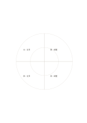

# 環状の四象限

`quadrant-rings` · `matrix` · `a5-draft`

[繁體中文](README.zh-TW.md) · [English](README.en.md) · [日本語](README.ja.md) · [一覧へ戻る](../../docs/ja/catalog.md)

方向による四分類と中心からの二段階を同時に使います。

## 向いている場面

- 四方向の近い場所と遠い場所の観察を比べるとき。
- 四種類の作業を早期と後期の二層に分けるとき。

## 使い方

1. 四方向が何を表すか自分で決めます。
2. 内側と外側を距離か優先度のどちらに使うか決めます。
3. 項目を扇形に置き、境界付近の例外を見直します。

## 記入後に見えること

複数の観点が交わる場所と、空白や選択上の差が見えます。

## 記入例

架空の地域菜園で四方向に分け、内側に近く行う作業、外側に調整待ちの事項を置きます。

[SVG](examples/ja.svg)

## 向いていない場面

円の面積は数量を示さず、項目が多いと領域が窮屈になります。

## ダウンロード

- [文字なしSVG](exports/a5-draft/blank.svg)
- [文字なしPDF](exports/a5-draft/blank.pdf)
- [左上に英語名があるPDF](exports/a5-draft/titled.pdf)
- [濃い線の文字なしPDF](exports/a5-contrast/blank.pdf)
- [濃い線のSVG](exports/a5-contrast/blank.svg)

英語名は表題付きPDFだけに印刷され、文字なし版は自由な記入に使えます。

用紙サイズ：A5（148 × 210 mm）。設定ファイル：`a5-draft`。

## 由来と状態

本プロジェクトの独自レイアウト · 詳しい由来の記録： [manifest.json](manifest.json)  
[MITライセンスの範囲](../../LICENSE-SCOPE.md)

[三言語の用語集](../../docs/ja/glossary.md)

## 変更と再生成

`profiles/a5-draft.json` または `src/noteformats/layouts/` の描画関数を変更し、プロジェクトのルートで実行します：

`python scripts/build.py --ids quadrant-rings`
