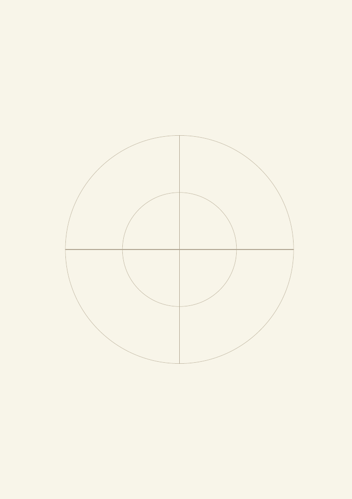
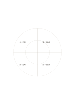

# 環帶四象限

`quadrant-rings` · `matrix` · `a5-draft`

[繁體中文](README.zh-TW.md) · [English](README.en.md) · [日本語](README.ja.md) · [返回目錄](../../docs/zh-TW/catalog.md)

同時用方向分區與距中心遠近兩層整理內容。

## 適合情境

- 比較四方位的近程與遠程觀察。
- 把四類工作分成先處理與後處理兩層。

## 使用步驟

1. 先自訂四個方向各代表什麼。
2. 再決定內圈與外圈分別代表近遠或優先層級。
3. 把項目放進扇區，回看分類邊界上的例外。

## 整理後可得到

看見兩個以上維度交叉處的資料缺口與取捨。

## 實際填寫示例

示例把虛構社區花園的四方位分區，每區內圈記近期可做的事、外圈記待協調事項。

[SVG](examples/zh-TW.svg)

## 不適合情境

圓環面積不能代表數量；項目太多時扇區也會變得擁擠。

## 下載

- [無字 SVG](exports/a5-draft/blank.svg)
- [無字 PDF](exports/a5-draft/blank.pdf)
- [左上角英文名稱 PDF](exports/a5-draft/titled.pdf)
- [深色墨線無字 PDF](exports/a5-contrast/blank.pdf)
- [深色墨線 SVG](exports/a5-contrast/blank.svg)

英文名稱只印在標題版 PDF；無字版仍適合自由列印與改作。

頁面尺寸：A5（148 × 210 mm）；設定檔：`a5-draft`。

## 來源與狀態

本專案原創版面 · 詳細來源紀錄見 [manifest.json](manifest.json)  
[MIT 授權範圍](../../LICENSE-SCOPE.md)

[三語術語表](../../docs/zh-TW/glossary.md)

## 修改與重新生成

修改 `profiles/a5-draft.json` 或 `src/noteformats/layouts/` 內對應的繪圖函式，再於專案根目錄執行：

`python scripts/build.py --ids quadrant-rings`
