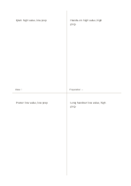

# Four-quadrant notes

`quadrant` · `matrix` · `a5-draft`

[繁體中文](README.zh-TW.md) · [English](README.en.md) · [日本語](README.ja.md) · [Back to catalog](../../docs/en/catalog.md)

Sort ideas into four areas defined by two dimensions you choose, then inspect the pattern.

## When to use it

- Compare workshop activities by participant value and preparation effort.
- Organize reading notes by topic and strength of evidence.

## How to use it

1. Choose two distinct dimensions and write your own meaning for each area on the sheet.
2. Place each short idea in the area that fits best.
3. Put uncertain ideas near a boundary and note what needs checking.
4. Compare the distribution and choose what to test or investigate next.

## What the page helps you see

Intersections, missing cells, and tradeoffs across chosen dimensions.

## Worked example

For a fictional small workshop, a live demonstration, a complete interactive lesson, question time, and a long handout are provisionally sorted by value and effort.

[SVG](examples/en.svg)

## When not to use it

Many interdependent conditions or decisions requiring precise weights cannot be resolved by four areas alone.

## Downloads

- [Wordless SVG](exports/a5-draft/blank.svg)
- [Wordless PDF](exports/a5-draft/blank.pdf)
- [PDF with English name at top left](exports/a5-draft/titled.pdf)
- [Darker-ink wordless PDF](exports/a5-contrast/blank.pdf)
- [Darker-ink SVG](exports/a5-contrast/blank.svg)

The English name appears only on the titled PDF; the wordless version remains available for free writing.

Page size: A5 (148 × 210 mm); profile: `a5-draft`.

## Provenance and status

Generic geometry · Detailed source record: [manifest.json](manifest.json)  
[MIT license scope](../../LICENSE-SCOPE.md)

[Trilingual glossary](../../docs/en/glossary.md)

## Modify and rebuild

Change `profiles/a5-draft.json` or the corresponding builder in `src/noteformats/layouts/`, then run from the project root:

`python scripts/build.py --ids quadrant`
