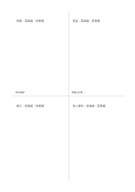

# 4象限ノート

`quadrant` · `matrix` · `a5-draft`

[繁體中文](README.zh-TW.md) · [English](README.en.md) · [日本語](README.ja.md) · [一覧へ戻る](../../docs/ja/catalog.md)

自分で決めた二つの観点で考えを四つに分け、偏りや抜けを見ます。

## 向いている場面

- ワークショップの案を参加価値と準備の手間で比べるとき。
- 読書メモを話題と根拠の強さで整理するとき。

## 使い方

1. 異なる二つの観点を選び、各領域の意味を自分で紙に書きます。
2. 考えを短い言葉にし、最も近い領域に置きます。
3. 判断できない案は境界付近に置き、確認すべき条件を添えます。
4. 分布を比べ、次に試す案や調べる点を選びます。

## 記入後に見えること

複数の観点が交わる場所と、空白や選択上の差が見えます。

## 記入例

架空の小規模ワークショップについて、実演、教材、質問時間、長い配布資料を参加価値と準備の手間で仮に分けています。

[SVG](examples/ja.svg)

## 向いていない場面

条件が複雑に依存する判断や、正確な重み付けが必要な判断は四つの領域だけでは扱えません。

## ダウンロード

- [文字なしSVG](exports/a5-draft/blank.svg)
- [文字なしPDF](exports/a5-draft/blank.pdf)
- [左上に英語名があるPDF](exports/a5-draft/titled.pdf)
- [濃い線の文字なしPDF](exports/a5-contrast/blank.pdf)
- [濃い線のSVG](exports/a5-contrast/blank.svg)

英語名は表題付きPDFだけに印刷され、文字なし版は自由な記入に使えます。

用紙サイズ：A5（148 × 210 mm）。設定ファイル：`a5-draft`。

## 由来と状態

一般的な幾何構造 · 詳しい由来の記録： [manifest.json](manifest.json)  
[MITライセンスの範囲](../../LICENSE-SCOPE.md)

[三言語の用語集](../../docs/ja/glossary.md)

## 変更と再生成

`profiles/a5-draft.json` または `src/noteformats/layouts/` の描画関数を変更し、プロジェクトのルートで実行します：

`python scripts/build.py --ids quadrant`
