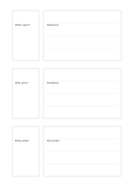

# Three question-answer pairs

`question-answer-triples` · `learning` · `a5-draft`

[繁體中文](README.zh-TW.md) · [English](README.en.md) · [日本語](README.ja.md) · [Back to catalog](../../docs/en/catalog.md)

Keep three checkable questions beside space for fuller answers.

## When to use it

- Write self-check questions after a short reading.
- Collect three frequent questions after a workshop.

## How to use it

1. Put one specific question in each small left area.
2. Hide the right side and try answering from memory before correcting it.
3. Mark uncertain points and verify them against the source.

## What the page helps you see

Concepts, cues, and recalled answers that can be checked against one another.

## Worked example

A fictional exhibition leaflet prompts 'When is it open?', 'Who can join?', and 'What to bring?', with answers checked against the leaflet.

[SVG](examples/en.svg)

## When not to use it

Three fixed pairs are poor for an open-ended discussion; unverified answers should not be treated as facts.

## Downloads

- [Wordless SVG](exports/a5-draft/blank.svg)
- [Wordless PDF](exports/a5-draft/blank.pdf)
- [PDF with English name at top left](exports/a5-draft/titled.pdf)
- [Darker-ink wordless PDF](exports/a5-contrast/blank.pdf)
- [Darker-ink SVG](exports/a5-contrast/blank.svg)

The English name appears only on the titled PDF; the wordless version remains available for free writing.

Page size: A5 (148 × 210 mm); profile: `a5-draft`.

## Provenance and status

Original layout · Detailed source record: [manifest.json](manifest.json)  
[MIT license scope](../../LICENSE-SCOPE.md)

[Trilingual glossary](../../docs/en/glossary.md)

## Modify and rebuild

Change `profiles/a5-draft.json` or the corresponding builder in `src/noteformats/layouts/`, then run from the project root:

`python scripts/build.py --ids question-answer-triples`
