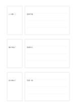

# 三組の質問と回答

`question-answer-triples` · `learning` · `a5-draft`

[繁體中文](README.zh-TW.md) · [English](README.en.md) · [日本語](README.ja.md) · [一覧へ戻る](../../docs/ja/catalog.md)

確かめられる質問を三つ作り、それぞれの長めの回答と並べます。

## 向いている場面

- 短い文章を読んだ後に理解を確認するとき。
- 講座後によく出た質問を三つまとめるとき。

## 使い方

1. 左の小枠に具体的な問いを一つずつ書きます。
2. 右側を隠して思い出して答え、後で修正します。
3. 不確かな箇所を印し、原資料で確認します。

## 記入後に見えること

概念、手がかり、思い出した答えを照合できます。

## 記入例

架空の展示案内から『いつ開く』『誰が参加』『何を持つ』を問いにし、案内と照らして答えます。

[SVG](examples/ja.svg)

## 向いていない場面

自由な長い議論には三組では足りません。未確認の答えを事実として扱わないでください。

## ダウンロード

- [文字なしSVG](exports/a5-draft/blank.svg)
- [文字なしPDF](exports/a5-draft/blank.pdf)
- [左上に英語名があるPDF](exports/a5-draft/titled.pdf)
- [濃い線の文字なしPDF](exports/a5-contrast/blank.pdf)
- [濃い線のSVG](exports/a5-contrast/blank.svg)

英語名は表題付きPDFだけに印刷され、文字なし版は自由な記入に使えます。

用紙サイズ：A5（148 × 210 mm）。設定ファイル：`a5-draft`。

## 由来と状態

本プロジェクトの独自レイアウト · 詳しい由来の記録： [manifest.json](manifest.json)  
[MITライセンスの範囲](../../LICENSE-SCOPE.md)

[三言語の用語集](../../docs/ja/glossary.md)

## 変更と再生成

`profiles/a5-draft.json` または `src/noteformats/layouts/` の描画関数を変更し、プロジェクトのルートで実行します：

`python scripts/build.py --ids question-answer-triples`
