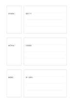

# 三組問答筆記

`question-answer-triples` · `learning` · `a5-draft`

[繁體中文](README.zh-TW.md) · [English](README.en.md) · [日本語](README.ja.md) · [返回目錄](../../docs/zh-TW/catalog.md)

把三個可檢查的問題和較長的回答成對記錄。

## 適合情境

- 讀完短文後自擬三題檢查理解。
- 工作坊結束後整理三個常見問題與回答。

## 使用步驟

1. 左側三小格各寫一個具體問題。
2. 右側先遮住答案，試著自行作答後再補正。
3. 圈出仍不確定的地方，回原文查證。

## 整理後可得到

把概念、線索與回想結果相互對照。

## 實際填寫示例

以虛構展覽簡介提問『何時開放』『誰可參加』『需要準備什麼』，右側寫可從簡介核對的回答。

[SVG](examples/zh-TW.svg)

## 不適合情境

三組固定問答不適合開放式長篇討論；不要把未核對的答案當成定論。

## 下載

- [無字 SVG](exports/a5-draft/blank.svg)
- [無字 PDF](exports/a5-draft/blank.pdf)
- [左上角英文名稱 PDF](exports/a5-draft/titled.pdf)
- [深色墨線無字 PDF](exports/a5-contrast/blank.pdf)
- [深色墨線 SVG](exports/a5-contrast/blank.svg)

英文名稱只印在標題版 PDF；無字版仍適合自由列印與改作。

頁面尺寸：A5（148 × 210 mm）；設定檔：`a5-draft`。

## 來源與狀態

本專案原創版面 · 詳細來源紀錄見 [manifest.json](manifest.json)  
[MIT 授權範圍](../../LICENSE-SCOPE.md)

[三語術語表](../../docs/zh-TW/glossary.md)

## 修改與重新生成

修改 `profiles/a5-draft.json` 或 `src/noteformats/layouts/` 內對應的繪圖函式，再於專案根目錄執行：

`python scripts/build.py --ids question-answer-triples`
