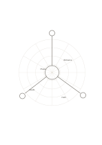

# Radial polar paper

`radial-polar` · `geometry` · `a5-draft`

[繁體中文](README.zh-TW.md) · [English](README.en.md) · [日本語](README.ja.md) · [Back to catalog](../../docs/en/catalog.md)

Use rings and rays to arrange directions and levels of distance from a center.

## When to use it

- Plan zones around a central stage.
- Compare observation positions by direction and approximate distance.

## How to use it

1. Write the object or place being studied at the center.
2. Define what the rings and directions mean for this page.
3. Place observations in sectors without treating unmeasured distance as a real value.

## What the page helps you see

A draft of direction, proportion, or placement, with measurements still to check.

## Worked example

A fictional small plaza sits in the center, with an entrance, seats, planting, and path shown in approximate directions.

[SVG](examples/en.svg)

## When not to use it

No angles or radii are numbered; precise polar plotting requires an added scale.

## Downloads

- [Wordless SVG](exports/a5-draft/blank.svg)
- [Wordless PDF](exports/a5-draft/blank.pdf)
- [PDF with English name at top left](exports/a5-draft/titled.pdf)
- [Darker-ink wordless PDF](exports/a5-contrast/blank.pdf)
- [Darker-ink SVG](exports/a5-contrast/blank.svg)

The English name appears only on the titled PDF; the wordless version remains available for free writing.

Page size: A5 (148 × 210 mm); profile: `a5-draft`.

## Provenance and status

Adaptation of traditional writing paper · Detailed source record: [manifest.json](manifest.json)  
[MIT license scope](../../LICENSE-SCOPE.md)

[Trilingual glossary](../../docs/en/glossary.md)

## Modify and rebuild

Change `profiles/a5-draft.json` or the corresponding builder in `src/noteformats/layouts/`, then run from the project root:

`python scripts/build.py --ids radial-polar`
