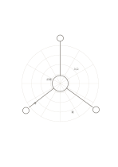

# 放射・極座標用紙

`radial-polar` · `geometry` · `a5-draft`

[繁體中文](README.zh-TW.md) · [English](README.en.md) · [日本語](README.ja.md) · [一覧へ戻る](../../docs/ja/catalog.md)

同心円と放射線で中心からの方向と距離の段階を整理します。

## 向いている場面

- 中心の舞台から外へ向かう区域を考えるとき。
- 観察する場所を方向と大まかな距離で比べるとき。

## 使い方

1. 中央に扱う物や場所を書きます。
2. 円環と方向がこのページで何を表すか自分で決めます。
3. 観察を扇形の領域に置き、未測定の距離を実測値とみなしません。

## 記入後に見えること

向き、比率、配置と、追加で測る箇所が見えます。

## 記入例

架空の小広場を中心に、入口、席、植栽、道の大まかな方向を示します。

[SVG](examples/ja.svg)

## 向いていない場面

角度や半径の数字はなく、精密な極座標図には別途目盛りが必要です。

## ダウンロード

- [文字なしSVG](exports/a5-draft/blank.svg)
- [文字なしPDF](exports/a5-draft/blank.pdf)
- [左上に英語名があるPDF](exports/a5-draft/titled.pdf)
- [濃い線の文字なしPDF](exports/a5-contrast/blank.pdf)
- [濃い線のSVG](exports/a5-contrast/blank.svg)

英語名は表題付きPDFだけに印刷され、文字なし版は自由な記入に使えます。

用紙サイズ：A5（148 × 210 mm）。設定ファイル：`a5-draft`。

## 由来と状態

伝統的な練習紙の応用 · 詳しい由来の記録： [manifest.json](manifest.json)  
[MITライセンスの範囲](../../LICENSE-SCOPE.md)

[三言語の用語集](../../docs/ja/glossary.md)

## 変更と再生成

`profiles/a5-draft.json` または `src/noteformats/layouts/` の描画関数を変更し、プロジェクトのルートで実行します：

`python scripts/build.py --ids radial-polar`
