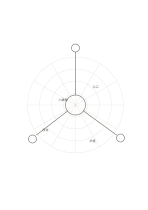

# 放射極座標紙

`radial-polar` · `geometry` · `a5-draft`

[繁體中文](README.zh-TW.md) · [English](README.en.md) · [日本語](README.ja.md) · [返回目錄](../../docs/zh-TW/catalog.md)

用同心圓與放射線整理距離中心的層次及方向。

## 適合情境

- 規劃以中心舞台向外的區域。
- 比較不同方向與距離的觀察位置。

## 使用步驟

1. 在中心寫下要討論的物件或場所。
2. 自行定義各圓環與方向代表的距離或層級。
3. 把觀察放入相應扇區，未量測的距離不要當成實值。

## 整理後可得到

看出方向、比例或空間配置中需要再測量之處。

## 實際填寫示例

示例以虛構小廣場為中心，標出入口、座位、植栽與周邊步道的大致方向。

[SVG](examples/zh-TW.svg)

## 不適合情境

線條沒有角度或半徑數字；精密極座標繪圖需要另外標定刻度。

## 下載

- [無字 SVG](exports/a5-draft/blank.svg)
- [無字 PDF](exports/a5-draft/blank.pdf)
- [左上角英文名稱 PDF](exports/a5-draft/titled.pdf)
- [深色墨線無字 PDF](exports/a5-contrast/blank.pdf)
- [深色墨線 SVG](exports/a5-contrast/blank.svg)

英文名稱只印在標題版 PDF；無字版仍適合自由列印與改作。

頁面尺寸：A5（148 × 210 mm）；設定檔：`a5-draft`。

## 來源與狀態

傳統書寫紙改編 · 詳細來源紀錄見 [manifest.json](manifest.json)  
[MIT 授權範圍](../../LICENSE-SCOPE.md)

[三語術語表](../../docs/zh-TW/glossary.md)

## 修改與重新生成

修改 `profiles/a5-draft.json` 或 `src/noteformats/layouts/` 內對應的繪圖函式，再於專案根目錄執行：

`python scripts/build.py --ids radial-polar`
