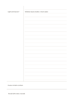

# Cornell notes with recall strip

`recall-strip` · `learning` · `a5-draft`

[繁體中文](README.zh-TW.md) · [English](README.en.md) · [日本語](README.ja.md) · [Back to catalog](../../docs/en/catalog.md)

Add a separate recall strip below Cornell notes for a cover-and-recall check. Geometry change: A separate recall strip is added below the Cornell zones.

## When to use it

**Geometry relationship:** `parameter` · [cornell](../cornell/README.en.md)

- Finish Cornell notes, then use the extra recall strip later to record what you still remember.
- Compare an after-lesson summary with a delayed recall entry to choose concepts to revisit.

## How to use it

1. Add a separate recall strip below Cornell notes for a cover-and-recall check.
2. Afterward, write a question or key term in the left column for each important section.
3. Cover the right area and answer from the cues alone.
4. Write the main conclusion in your own words at the bottom, including anything still unclear.

## What the page helps you see

Record recall in a separate strip, then compare it with the notes to see which points remain unclear.

## Worked example

A fictional plant observation lesson uses the main area for light and leaf observations, the cue column for a question about leaf color, and the bottom for a cautious conclusion. The fictional entries indicate where short notes belong; they are neither measured data nor a complete research conclusion.

[SVG](examples/en.svg)

## When not to use it

The extra strip holds a brief recall result rather than a full answer; copying the summary above into it does not test what you can remember unaided.

## Downloads

- [Wordless SVG](exports/a5-draft/blank.svg)
- [Wordless PDF](exports/a5-draft/blank.pdf)
- [PDF with English name at top left](exports/a5-draft/titled.pdf)
- [Darker-ink wordless PDF](exports/a5-contrast/blank.pdf)
- [Darker-ink SVG](exports/a5-contrast/blank.svg)

The English name appears only on the titled PDF; the wordless version remains available for free writing.

Page size: A5 (148 × 210 mm); profile: `a5-draft`.

## Provenance and status

Adaptation of an existing method · Detailed source record: [manifest.json](manifest.json)  
[MIT license scope](../../LICENSE-SCOPE.md)

[Trilingual glossary](../../docs/en/glossary.md)

## Modify and rebuild

Edit geometry in `src/noteformats/variants.py` or text in `src/noteformats/variant_content.py`, then run from the project root:

`python scripts/build.py --ids recall-strip`
