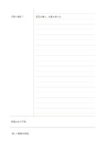

# 想起欄つきコーネル式

`recall-strip` · `learning` · `a5-draft`

[繁體中文](README.zh-TW.md) · [English](README.en.md) · [日本語](README.ja.md) · [一覧へ戻る](../../docs/ja/catalog.md)

コーネル式の下に想起欄を設け、答えを隠して確かめます。 図形の変更： コーネル式の領域の下に想起用の帯を追加しました。

## 向いている場面

**図形の対応:** `parameter` · [cornell](../cornell/README.ja.md)

- コーネル式の記録を終え、時間を置いて追加の想起帯に覚えている内容を書くとき。
- 授業直後の要約と後の想起記録を比べ、読み直す概念を選ぶとき。

## 使い方

1. コーネル式の下に想起欄を設け、答えを隠して確かめます。
2. 整理するとき、右欄のまとまりに対応する問いや語句を左欄に書きます。
3. 右欄を隠し、左欄だけを見て答えを説明してみます。
4. 下欄に最も大事な結論と、まだ分からない点を自分の言葉で書きます。

## 記入後に見えること

想起した内容を別の帯に書き、元のノートと比べて曖昧な点を確かめられます。

## 記入例

架空の植物観察授業を例に、右欄へ日照と葉の変化、左欄へ葉色の問い、下欄へ慎重な結論を書いています。 架空の短い記入で各領域の使い方を示します。実測データや完全な調査結果ではありません。

[SVG](examples/ja.svg)

## 向いていない場面

追加の想起帯は短い想起結果のための欄で、十分な答えを書く領域の代わりにはなりません。上の要約を書き写すだけでは自力での想起を確かめられません。

## ダウンロード

- [文字なしSVG](exports/a5-draft/blank.svg)
- [文字なしPDF](exports/a5-draft/blank.pdf)
- [左上に英語名があるPDF](exports/a5-draft/titled.pdf)
- [濃い線の文字なしPDF](exports/a5-contrast/blank.pdf)
- [濃い線のSVG](exports/a5-contrast/blank.svg)

英語名は表題付きPDFだけに印刷され、文字なし版は自由な記入に使えます。

用紙サイズ：A5（148 × 210 mm）。設定ファイル：`a5-draft`。

## 由来と状態

既存の方法を配置に応用 · 詳しい由来の記録： [manifest.json](manifest.json)  
[MITライセンスの範囲](../../LICENSE-SCOPE.md)

[三言語の用語集](../../docs/ja/glossary.md)

## 変更と再生成

図形は `src/noteformats/variants.py`、文章は `src/noteformats/variant_content.py` を変更し、プロジェクトのルートで実行します：

`python scripts/build.py --ids recall-strip`
