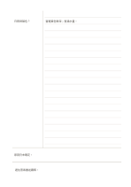

# 康乃爾式筆記頁（附回想條）

`recall-strip` · `learning` · `a5-draft`

[繁體中文](README.zh-TW.md) · [English](README.en.md) · [日本語](README.ja.md) · [返回目錄](../../docs/zh-TW/catalog.md)

在康乃爾筆記下方另設回想區，遮住答案後自我測試。 本款的幾何變化： 在康乃爾分區下方另留一條回想區。

## 適合情境

**幾何對照:** `parameter` · [cornell](../cornell/README.zh-TW.md)

- 先完成康乃爾筆記，再隔一段時間於額外回想帶寫下仍記得的內容。
- 比較課後摘要與稍後的回想記錄，找出需回讀的概念。

## 使用步驟

1. 在康乃爾筆記下方另設回想區，遮住答案後自我測試。
2. 整理時在左欄寫問題或關鍵詞，每一項對應右側的一段。
3. 遮住右側，試著只看左欄口述答案。
4. 在下方用自己的話寫出這頁最重要的結論，並標出仍不明白處。

## 整理後可得到

把回想結果寫進獨立區域，對照原筆記檢查哪些重點仍記不清。

## 實際填寫示例

虛構的植物觀察課：右欄記日照與葉片變化，左欄提出『日照如何影響葉色？』，底欄寫目前可支持的簡短結論。 示例以虛構資料在對應區域放入短語，示意填寫位置；不是實測或完整研究結論。

[SVG](examples/zh-TW.svg)

## 不適合情境

額外回想帶只能留下精簡的回想結果，不能取代完整答案區；若只是照抄上方摘要，就無法用來檢查自己記得多少。

## 下載

- [無字 SVG](exports/a5-draft/blank.svg)
- [無字 PDF](exports/a5-draft/blank.pdf)
- [左上角英文名稱 PDF](exports/a5-draft/titled.pdf)
- [深色墨線無字 PDF](exports/a5-contrast/blank.pdf)
- [深色墨線 SVG](exports/a5-contrast/blank.svg)

英文名稱只印在標題版 PDF；無字版仍適合自由列印與改作。

頁面尺寸：A5（148 × 210 mm）；設定檔：`a5-draft`。

## 來源與狀態

既有方法的版面改編 · 詳細來源紀錄見 [manifest.json](manifest.json)  
[MIT 授權範圍](../../LICENSE-SCOPE.md)

[三語術語表](../../docs/zh-TW/glossary.md)

## 修改與重新生成

調整 `src/noteformats/variants.py` 的幾何或 `src/noteformats/variant_content.py` 的文字，再於專案根目錄執行：

`python scripts/build.py --ids recall-strip`
