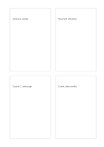

# Four research index cards

`research-index-cards` · `research` · `a5-draft`

[繁體中文](README.zh-TW.md) · [English](README.en.md) · [日本語](README.ja.md) · [Back to catalog](../../docs/en/catalog.md)

Record three distinct sources and one unresolved conflict on four cards.

## When to use it

**Geometry relationship:** `equivalent` · [four-cards](../four-cards/README.en.md)

- Make one index card for each of four sources, recording provenance, a claim and open checks.
- Create separate cards for four research leads so material from different sources stays distinct.

## How to use it

1. Assign each of the four cards to a source or research lead and record how to find it again.
2. Put a claim, relevant quotation and open question on each card without mixing sources.
3. Compare agreements and conflicts across the four cards and list material to seek next.

## What the page helps you see

Sources, quotations, claims, and open checks kept distinct.

## Worked example

Entries in example-position order; each number identifies one entry:

1. Source A: poster
2. Source B: interview
3. Source C: web page
4. Check: date conflict

[SVG](examples/en.svg)

## When not to use it

Four index cards organize selected research leads but do not assess source reliability; each still needs enough author, date or location information to find its source again.

## Downloads

- [Wordless SVG](exports/a5-draft/blank.svg)
- [Wordless PDF](exports/a5-draft/blank.pdf)
- [PDF with English name at top left](exports/a5-draft/titled.pdf)
- [Darker-ink wordless PDF](exports/a5-contrast/blank.pdf)
- [Darker-ink SVG](exports/a5-contrast/blank.svg)

The English name appears only on the titled PDF; the wordless version remains available for free writing.

Page size: A5 (148 × 210 mm); profile: `a5-draft`.

## Provenance and status

Generic geometry · Detailed source record: [manifest.json](manifest.json)  
[MIT license scope](../../LICENSE-SCOPE.md)

[Trilingual glossary](../../docs/en/glossary.md)

## Modify and rebuild

Edit geometry in `src/noteformats/variants.py` or text in `src/noteformats/variant_content.py`, then run from the project root:

`python scripts/build.py --ids research-index-cards`
