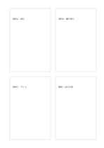

# 調査用の四枚の索引カード

`research-index-cards` · `research` · `a5-draft`

[繁體中文](README.zh-TW.md) · [English](README.en.md) · [日本語](README.ja.md) · [一覧へ戻る](../../docs/ja/catalog.md)

三枚に異なる資料、四枚目に未確認の食い違いを記します。

## 向いている場面

**図形の対応:** `equivalent` · [four-cards](../four-cards/README.ja.md)

- 四つの資料を一枚ずつ索引カードにし、出典・主張・確認点を残すとき。
- 文章の四つの調査の手がかりを別カードにし、出典を混ぜないようにするとき。

## 使い方

1. 四枚のカードに資料か調査の手がかりを一つずつ割り当て、再確認できる出典を書きます。
2. 各カードに主張・関連する引用・問いを記し、別資料の内容を混ぜません。
3. 四枚の共通点と食い違いを比べ、次に集める資料を挙げます。

## 記入後に見えること

資料、引用、主張、未確認事項を分けられます。

## 記入例

図の記入位置の順に示します。番号一つが一つの記入例です：

1. 資料A：掲示
2. 資料B：聞き取り
3. 資料C：サイト
4. 確認：日付の差

[SVG](examples/ja.svg)

## 向いていない場面

四枚の索引カードは選んだ調査の手がかりを整理するもので、出典の信頼性を自動で評価しません。著者・日付・場所など再確認できる情報を残します。

## ダウンロード

- [文字なしSVG](exports/a5-draft/blank.svg)
- [文字なしPDF](exports/a5-draft/blank.pdf)
- [左上に英語名があるPDF](exports/a5-draft/titled.pdf)
- [濃い線の文字なしPDF](exports/a5-contrast/blank.pdf)
- [濃い線のSVG](exports/a5-contrast/blank.svg)

英語名は表題付きPDFだけに印刷され、文字なし版は自由な記入に使えます。

用紙サイズ：A5（148 × 210 mm）。設定ファイル：`a5-draft`。

## 由来と状態

一般的な幾何構造 · 詳しい由来の記録： [manifest.json](manifest.json)  
[MITライセンスの範囲](../../LICENSE-SCOPE.md)

[三言語の用語集](../../docs/ja/glossary.md)

## 変更と再生成

図形は `src/noteformats/variants.py`、文章は `src/noteformats/variant_content.py` を変更し、プロジェクトのルートで実行します：

`python scripts/build.py --ids research-index-cards`
