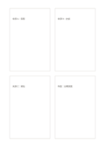

# 研究索引四卡

`research-index-cards` · `research` · `a5-draft`

[繁體中文](README.zh-TW.md) · [English](README.en.md) · [日本語](README.ja.md) · [返回目錄](../../docs/zh-TW/catalog.md)

三卡記不同來源，第四卡記待核對的衝突。

## 適合情境

**幾何對照:** `equivalent` · [four-cards](../four-cards/README.zh-TW.md)

- 將四份資料各做一張索引卡，記下來源、主張與待核事項。
- 為文章的四個研究線索建立獨立卡片，避免不同來源混在一起。

## 使用步驟

1. 四張卡各指定一份資料或一條研究線索，先寫可回查的來源。
2. 每卡記一項主張、相關引文與待查問題，避免混入另一份資料的內容。
3. 比對四卡的共同點與衝突，列出下一輪要補的資料。

## 整理後可得到

分開來源、引文、主張與待查問題。

## 實際填寫示例

依圖中填寫位置順序列出，每個編號是一筆示例條目：

1. 來源 A：海報
2. 來源 B：訪談
3. 來源 C：網站
4. 待查：日期差異

[SVG](examples/zh-TW.svg)

## 不適合情境

四張索引卡只能整理選入的研究線索，不會自動評估來源可信度；每卡仍須保留足以回查的作者、日期或位置資訊。

## 下載

- [無字 SVG](exports/a5-draft/blank.svg)
- [無字 PDF](exports/a5-draft/blank.pdf)
- [左上角英文名稱 PDF](exports/a5-draft/titled.pdf)
- [深色墨線無字 PDF](exports/a5-contrast/blank.pdf)
- [深色墨線 SVG](exports/a5-contrast/blank.svg)

英文名稱只印在標題版 PDF；無字版仍適合自由列印與改作。

頁面尺寸：A5（148 × 210 mm）；設定檔：`a5-draft`。

## 來源與狀態

通用幾何結構 · 詳細來源紀錄見 [manifest.json](manifest.json)  
[MIT 授權範圍](../../LICENSE-SCOPE.md)

[三語術語表](../../docs/zh-TW/glossary.md)

## 修改與重新生成

調整 `src/noteformats/variants.py` 的幾何或 `src/noteformats/variant_content.py` 的文字，再於專案根目錄執行：

`python scripts/build.py --ids research-index-cards`
