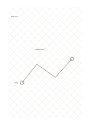

# Rhombus grid

`rhombus-grid` · `geometry` · `a5-draft`

[繁體中文](README.zh-TW.md) · [English](README.en.md) · [日本語](README.ja.md) · [Back to catalog](../../docs/en/catalog.md)

Cross two diagonal line families to study diamond cells and rotated square arrangements.

## When to use it

- Try a diagonal tiling pattern.
- Compare how an object occupies space when placed straight or at an angle.

## How to use it

1. Choose one diamond as a placement unit.
2. Trace boundaries and repeats along the diagonal lines.
3. Decide whether a separate horizontal or vertical reference must be noted.

## What the page helps you see

A draft of direction, proportion, or placement, with measurements still to check.

## Worked example

A fictional floor-tile layout uses diamonds for its angled repeat and marks the entrance and turning point.

[SVG](examples/en.svg)

## When not to use it

Diagonal cells burden horizontal prose or right-angle coordinates.

## Downloads

- [Wordless SVG](exports/a5-draft/blank.svg)
- [Wordless PDF](exports/a5-draft/blank.pdf)
- [PDF with English name at top left](exports/a5-draft/titled.pdf)
- [Darker-ink wordless PDF](exports/a5-contrast/blank.pdf)
- [Darker-ink SVG](exports/a5-contrast/blank.svg)

The English name appears only on the titled PDF; the wordless version remains available for free writing.

Page size: A5 (148 × 210 mm); profile: `a5-draft`.

## Provenance and status

Adaptation of traditional writing paper · Detailed source record: [manifest.json](manifest.json)  
[MIT license scope](../../LICENSE-SCOPE.md)

[Trilingual glossary](../../docs/en/glossary.md)

## Modify and rebuild

Change `profiles/a5-draft.json` or the corresponding builder in `src/noteformats/layouts/`, then run from the project root:

`python scripts/build.py --ids rhombus-grid`
