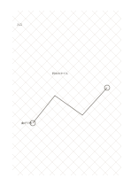

# ひし形方眼

`rhombus-grid` · `geometry` · `a5-draft`

[繁體中文](README.zh-TW.md) · [English](README.en.md) · [日本語](README.ja.md) · [一覧へ戻る](../../docs/ja/catalog.md)

交差する二組の斜線でひし形を作り、傾けた配置を考えます。

## 向いている場面

- 斜めに並ぶ敷き方を試すとき。
- 物を正面向きと斜め向きに置いた場合を比べるとき。

## 使い方

1. ひし形一つを配置の単位として選びます。
2. 斜線に沿って境界と繰り返す方向を描きます。
3. 水平や垂直の基準を別に書く必要があるか確かめます。

## 記入後に見えること

向き、比率、配置と、追加で測る箇所が見えます。

## 記入例

架空の床タイルを斜めに並べ、入口と曲がる位置を示しています。

[SVG](examples/ja.svg)

## 向いていない場面

横書きの文章や直角座標を中心に使う場合、斜線が読みづらさを増します。

## ダウンロード

- [文字なしSVG](exports/a5-draft/blank.svg)
- [文字なしPDF](exports/a5-draft/blank.pdf)
- [左上に英語名があるPDF](exports/a5-draft/titled.pdf)
- [濃い線の文字なしPDF](exports/a5-contrast/blank.pdf)
- [濃い線のSVG](exports/a5-contrast/blank.svg)

英語名は表題付きPDFだけに印刷され、文字なし版は自由な記入に使えます。

用紙サイズ：A5（148 × 210 mm）。設定ファイル：`a5-draft`。

## 由来と状態

伝統的な練習紙の応用 · 詳しい由来の記録： [manifest.json](manifest.json)  
[MITライセンスの範囲](../../LICENSE-SCOPE.md)

[三言語の用語集](../../docs/ja/glossary.md)

## 変更と再生成

`profiles/a5-draft.json` または `src/noteformats/layouts/` の描画関数を変更し、プロジェクトのルートで実行します：

`python scripts/build.py --ids rhombus-grid`
