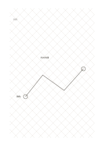

# 菱形網格

`rhombus-grid` · `geometry` · `a5-draft`

[繁體中文](README.zh-TW.md) · [English](README.en.md) · [日本語](README.ja.md) · [返回目錄](../../docs/zh-TW/catalog.md)

以兩組交叉斜線形成菱形，方便觀察旋轉後的方格配置。

## 適合情境

- 試畫斜向鋪排的圖案。
- 比較物件正放與斜放時的占位。

## 使用步驟

1. 先選一個菱格作為配置單位。
2. 沿斜線畫出邊界與重複方向。
3. 檢查圖案是否需要另外標註水平或垂直基準。

## 整理後可得到

看出方向、比例或空間配置中需要再測量之處。

## 實際填寫示例

示例用菱格草擬虛構地磚的斜向排列，標出入口與轉角位置。

[SVG](examples/zh-TW.svg)

## 不適合情境

若主要內容是水平文字或直角座標，菱形斜線會增加閱讀負擔。

## 下載

- [無字 SVG](exports/a5-draft/blank.svg)
- [無字 PDF](exports/a5-draft/blank.pdf)
- [左上角英文名稱 PDF](exports/a5-draft/titled.pdf)
- [深色墨線無字 PDF](exports/a5-contrast/blank.pdf)
- [深色墨線 SVG](exports/a5-contrast/blank.svg)

英文名稱只印在標題版 PDF；無字版仍適合自由列印與改作。

頁面尺寸：A5（148 × 210 mm）；設定檔：`a5-draft`。

## 來源與狀態

傳統書寫紙改編 · 詳細來源紀錄見 [manifest.json](manifest.json)  
[MIT 授權範圍](../../LICENSE-SCOPE.md)

[三語術語表](../../docs/zh-TW/glossary.md)

## 修改與重新生成

修改 `profiles/a5-draft.json` 或 `src/noteformats/layouts/` 內對應的繪圖函式，再於專案根目錄執行：

`python scripts/build.py --ids rhombus-grid`
