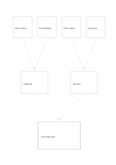

# Converging root-cause tree

`root-cause-tree` · `causal` · `a5-draft`

[繁體中文](README.zh-TW.md) · [English](README.en.md) · [日本語](README.ja.md) · [Back to catalog](../../docs/en/catalog.md)

Bring four candidate causes through two groups toward one observed outcome, keeping each causal link open to checking.

## When to use it

**Geometry relationship:** `independent` · [decision-tree](../decision-tree/README.en.md)

- Group possible reasons for low sign-ups into publicity and access conditions.
- Investigate whether two kinds of conditions contribute to a process error.

## How to use it

1. Write an observable outcome at the bottom.
2. Place four candidate causes above and name two explanatory groups in the middle.
3. Trace every arrow back to evidence and remove unsupported links.

## What the page helps you see

Observed outcomes separated from causal hypotheses and unsupported links.

## Worked example

Late notice, few details, a time clash, and a long trip are grouped as publicity and access hypotheses before pointing to low sign-ups.

[SVG](examples/en.svg)

## When not to use it

A drawn arrow is not causal proof; use a network or separate evidence notes when causes interact.

## Downloads

- [Wordless SVG](exports/a5-draft/blank.svg)
- [Wordless PDF](exports/a5-draft/blank.pdf)
- [PDF with English name at top left](exports/a5-draft/titled.pdf)
- [Darker-ink wordless PDF](exports/a5-contrast/blank.pdf)
- [Darker-ink SVG](exports/a5-contrast/blank.svg)

The English name appears only on the titled PDF; the wordless version remains available for free writing.

Page size: A5 (148 × 210 mm); profile: `a5-draft`.

## Provenance and status

Adaptation of a traditional format · Detailed source record: [manifest.json](manifest.json)  
[MIT license scope](../../LICENSE-SCOPE.md)

[Trilingual glossary](../../docs/en/glossary.md)

## Modify and rebuild

Edit geometry in `src/noteformats/variants.py` or text in `src/noteformats/variant_content.py`, then run from the project root:

`python scripts/build.py --ids root-cause-tree`
