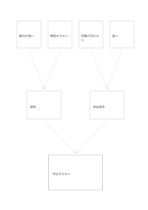

# 原因が集まる樹形図

`root-cause-tree` · `causal` · `a5-draft`

[繁體中文](README.zh-TW.md) · [English](README.en.md) · [日本語](README.ja.md) · [一覧へ戻る](../../docs/ja/catalog.md)

四つの原因候補を二群にまとめ、一つの観察結果に向けて因果の仮説を点検します。

## 向いている場面

**図形の対応:** `independent` · [decision-tree](../decision-tree/README.ja.md)

- 申込が少ない理由を周知と参加条件に分ける場合。
- 作業の誤りに二種類の条件が関わるか調べる場合。

## 使い方

1. 最下段に観察できる結果を書きます。
2. 上の四枠に候補、中間の二枠に説明できる群を書きます。
3. 各矢印の根拠を調べ、支えられない関係は外します。

## 記入後に見えること

観察結果と原因の仮説を分け、根拠のない関係を示せます。

## 記入例

案内の遅れ、情報不足、時間の衝突、遠い移動を周知と参加条件の仮説としてまとめ、申込減少につなぎます。

[SVG](examples/ja.svg)

## 向いていない場面

描いた矢印だけでは因果を証明できません。要因同士が影響し合う場合は別の図や根拠の記録が必要です。

## ダウンロード

- [文字なしSVG](exports/a5-draft/blank.svg)
- [文字なしPDF](exports/a5-draft/blank.pdf)
- [左上に英語名があるPDF](exports/a5-draft/titled.pdf)
- [濃い線の文字なしPDF](exports/a5-contrast/blank.pdf)
- [濃い線のSVG](exports/a5-contrast/blank.svg)

英語名は表題付きPDFだけに印刷され、文字なし版は自由な記入に使えます。

用紙サイズ：A5（148 × 210 mm）。設定ファイル：`a5-draft`。

## 由来と状態

伝統的な形式の応用 · 詳しい由来の記録： [manifest.json](manifest.json)  
[MITライセンスの範囲](../../LICENSE-SCOPE.md)

[三言語の用語集](../../docs/ja/glossary.md)

## 変更と再生成

図形は `src/noteformats/variants.py`、文章は `src/noteformats/variant_content.py` を変更し、プロジェクトのルートで実行します：

`python scripts/build.py --ids root-cause-tree`
