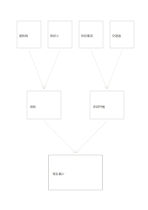

# 原因匯流樹

`root-cause-tree` · `causal` · `a5-draft`

[繁體中文](README.zh-TW.md) · [English](README.en.md) · [日本語](README.ja.md) · [返回目錄](../../docs/zh-TW/catalog.md)

由四個原因候選經兩個類別匯向一個觀察結果，檢視哪些連結仍需查證。

## 適合情境

**幾何對照:** `independent` · [decision-tree](../decision-tree/README.zh-TW.md)

- 把報名偏少的原因假設按周知與參與門檻整理。
- 追查流程錯誤是否來自兩組不同條件。

## 使用步驟

1. 最下方寫可觀察結果。
2. 上方四格分別寫原因候選，中間兩格為可解釋的群組。
3. 沿箭頭回查每條關係的證據，刪掉無法支持的連結。

## 整理後可得到

分開觀察結果與原因假設，標出尚無證據的連結。

## 實際填寫示例

虛構活動的晚通知、資訊少、時段衝突及交通遠先歸為周知與參與門檻，最後指向報名偏少；全部仍是待驗證假設。

[SVG](examples/zh-TW.svg)

## 不適合情境

線條不構成因果證明；若原因互相影響，改用網絡圖或另外記錄資料。

## 下載

- [無字 SVG](exports/a5-draft/blank.svg)
- [無字 PDF](exports/a5-draft/blank.pdf)
- [左上角英文名稱 PDF](exports/a5-draft/titled.pdf)
- [深色墨線無字 PDF](exports/a5-contrast/blank.pdf)
- [深色墨線 SVG](exports/a5-contrast/blank.svg)

英文名稱只印在標題版 PDF；無字版仍適合自由列印與改作。

頁面尺寸：A5（148 × 210 mm）；設定檔：`a5-draft`。

## 來源與狀態

傳統格式改編 · 詳細來源紀錄見 [manifest.json](manifest.json)  
[MIT 授權範圍](../../LICENSE-SCOPE.md)

[三語術語表](../../docs/zh-TW/glossary.md)

## 修改與重新生成

調整 `src/noteformats/variants.py` 的幾何或 `src/noteformats/variant_content.py` 的文字，再於專案根目錄執行：

`python scripts/build.py --ids root-cause-tree`
