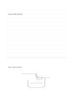

# Ruled notes above sketch

`ruled-and-sketch` · `hybrid` · `a5-draft`

[繁體中文](README.zh-TW.md) · [English](README.en.md) · [日本語](README.ja.md) · [Back to catalog](../../docs/en/catalog.md)

Write key notes above and test placement and proportion in a sketch below. Geometry change: Ruled notes sit above an open sketch area.

## When to use it

**Geometry relationship:** `parameter` · [ruled-sketch-top](../ruled-sketch-top/README.en.md)

- Record interview clues on the upper ruled area, then sketch a possible object arrangement below.
- Write a description in the upper half and use the lower sketch to check your spatial understanding.

## How to use it

1. Record verbal cues on the upper lines and a related sketch below, marking their links.
2. Use the worked example to place entries in region order: 1: "Inlet and filter position"; 2: "Rain collector sketch"
3. Review the regions, mark open questions and choose a next step.

## What the page helps you see

A drawing, short notes, and a conclusion kept separate but connected.

## Worked example

Entries in example-position order; each number identifies one entry:

1. Inlet and filter position
2. Rain collector sketch

[SVG](examples/en.svg)

## When not to use it

The sketch area is wasted for text-only work; a drawing needing page-wide precision belongs on a blank sheet. Small cells hold short phrases rather than long paragraphs.

## Downloads

- [Wordless SVG](exports/a5-draft/blank.svg)
- [Wordless PDF](exports/a5-draft/blank.pdf)
- [PDF with English name at top left](exports/a5-draft/titled.pdf)
- [Darker-ink wordless PDF](exports/a5-contrast/blank.pdf)
- [Darker-ink SVG](exports/a5-contrast/blank.svg)

The English name appears only on the titled PDF; the wordless version remains available for free writing.

Page size: A5 (148 × 210 mm); profile: `a5-draft`.

## Provenance and status

Original mixed layout · Detailed source record: [manifest.json](manifest.json)  
[MIT license scope](../../LICENSE-SCOPE.md)

[Trilingual glossary](../../docs/en/glossary.md)

## Modify and rebuild

Edit geometry in `src/noteformats/variants.py` or text in `src/noteformats/variant_content.py`, then run from the project root:

`python scripts/build.py --ids ruled-and-sketch`
