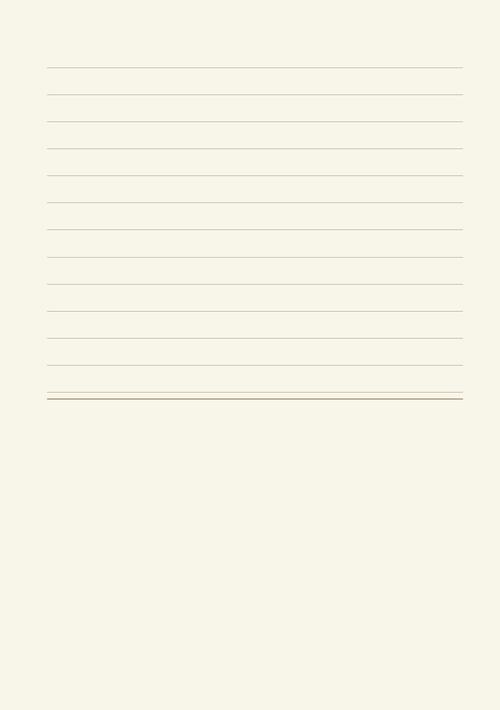
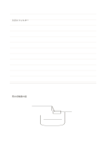

# 上に横罫、下に下書き

`ruled-and-sketch` · `hybrid` · `a5-draft`

[繁體中文](README.zh-TW.md) · [English](README.en.md) · [日本語](README.ja.md) · [一覧へ戻る](../../docs/ja/catalog.md)

上に要点を書き、下の草図で位置と比率を確かめます。 図形の変更： 上を横罫、下を自由なスケッチ領域にしました。

## 向いている場面

**図形の対応:** `parameter` · [ruled-sketch-top](../ruled-sketch-top/README.ja.md)

- 上の罫線に聞き取りの手がかりを書き、下に物の配置案を描くとき。
- 上半分に説明を書き、下半分の図で空間関係の理解を確かめるとき。

## 使い方

1. 上の罫線に言葉の手がかり、下に対応する図を描き、関係を示します。
2. 記入例を参考に、領域の順で記します：1「入口とフィルター」；2「雨水収集器の図」
3. 各領域を読み返し、未確認の点と次の行動を記します。

## 記入後に見えること

図、短い記録、結論を分けながら関係づけられます。

## 記入例

図の記入位置の順に示します。番号一つが一つの記入例です：

1. 入口とフィルター
2. 雨水収集器の図

[SVG](examples/ja.svg)

## 向いていない場面

文章だけなら描画欄が余ります。全面を精密に描くなら無地のページが適します。 小さなマスは短い語句向けで、長い文章には向きません。

## ダウンロード

- [文字なしSVG](exports/a5-draft/blank.svg)
- [文字なしPDF](exports/a5-draft/blank.pdf)
- [左上に英語名があるPDF](exports/a5-draft/titled.pdf)
- [濃い線の文字なしPDF](exports/a5-contrast/blank.pdf)
- [濃い線のSVG](exports/a5-contrast/blank.svg)

英語名は表題付きPDFだけに印刷され、文字なし版は自由な記入に使えます。

用紙サイズ：A5（148 × 210 mm）。設定ファイル：`a5-draft`。

## 由来と状態

本プロジェクトの独自の複合配置 · 詳しい由来の記録： [manifest.json](manifest.json)  
[MITライセンスの範囲](../../LICENSE-SCOPE.md)

[三言語の用語集](../../docs/ja/glossary.md)

## 変更と再生成

図形は `src/noteformats/variants.py`、文章は `src/noteformats/variant_content.py` を変更し、プロジェクトのルートで実行します：

`python scripts/build.py --ids ruled-and-sketch`
