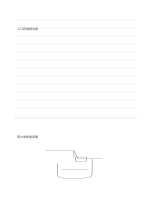

# 上線下圖筆記

`ruled-and-sketch` · `hybrid` · `a5-draft`

[繁體中文](README.zh-TW.md) · [English](README.en.md) · [日本語](README.ja.md) · [返回目錄](../../docs/zh-TW/catalog.md)

上方先記重點，下方以草圖驗證位置與比例。 本款的幾何變化： 上方橫線、下方空白草圖區。

## 適合情境

**幾何對照:** `parameter` · [ruled-sketch-top](../ruled-sketch-top/README.zh-TW.md)

- 先在上方橫線整理訪談線索，再於下方畫出可能的物件配置。
- 把文字描述寫在上半頁，用下半頁草圖檢查自己是否理解空間關係。

## 使用步驟

1. 上方橫線記文字線索，下方畫對應草圖，標出圖文間的關係。
2. 參考本頁示例，各區依序記錄：1「入口與濾網位置」；2「雨水收集器草圖」
3. 回看各區，標記仍待查證的內容，再決定下一步。

## 整理後可得到

把圖、短記與結論放在各自區域，再檢查關係。

## 實際填寫示例

依圖中填寫位置順序列出，每個編號是一筆示例條目：

1. 入口與濾網位置
2. 雨水收集器草圖

[SVG](examples/zh-TW.svg)

## 不適合情境

如果全部內容都是長文，空白畫區可能浪費；若圖需要滿頁精度，也應選全空白頁。 細小格子只宜短語，不適合長篇段落。

## 下載

- [無字 SVG](exports/a5-draft/blank.svg)
- [無字 PDF](exports/a5-draft/blank.pdf)
- [左上角英文名稱 PDF](exports/a5-draft/titled.pdf)
- [深色墨線無字 PDF](exports/a5-contrast/blank.pdf)
- [深色墨線 SVG](exports/a5-contrast/blank.svg)

英文名稱只印在標題版 PDF；無字版仍適合自由列印與改作。

頁面尺寸：A5（148 × 210 mm）；設定檔：`a5-draft`。

## 來源與狀態

本專案原創混合版面 · 詳細來源紀錄見 [manifest.json](manifest.json)  
[MIT 授權範圍](../../LICENSE-SCOPE.md)

[三語術語表](../../docs/zh-TW/glossary.md)

## 修改與重新生成

調整 `src/noteformats/variants.py` 的幾何或 `src/noteformats/variant_content.py` 的文字，再於專案根目錄執行：

`python scripts/build.py --ids ruled-and-sketch`
