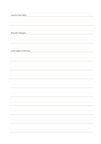

# Double-ruled writing

`ruled-double` · `foundation` · `a5-draft`

[繁體中文](README.zh-TW.md) · [English](README.en.md) · [日本語](README.ja.md) · [Back to catalog](../../docs/en/catalog.md)

Pairs of lines form writing bands for practicing consistent height and spacing.

## When to use it

- Compare letter height during handwriting practice.
- Copy short sentences while keeping a clear baseline band.

## How to use it

1. Treat one pair of lines as the upper and lower edge of a writing band.
2. Place one short sentence inside the band without spilling into the next pair.
3. After a few lines, compare height and whitespace before adjusting the next line.

## What the page helps you see

A continuous note or draft that can be revisited, with unresolved points marked.

## Worked example

Three fictional plant-observation phrases are written in separate bands to compare height and spacing.

[SVG](examples/en.svg)

## When not to use it

The paired guides are restrictive for fast long-form notes or large sketches.

## Downloads

- [Wordless SVG](exports/a5-draft/blank.svg)
- [Wordless PDF](exports/a5-draft/blank.pdf)
- [PDF with English name at top left](exports/a5-draft/titled.pdf)
- [Darker-ink wordless PDF](exports/a5-contrast/blank.pdf)
- [Darker-ink SVG](exports/a5-contrast/blank.svg)

The English name appears only on the titled PDF; the wordless version remains available for free writing.

Page size: A5 (148 × 210 mm); profile: `a5-draft`.

## Provenance and status

Adaptation of traditional writing paper · Detailed source record: [manifest.json](manifest.json)  
[MIT license scope](../../LICENSE-SCOPE.md)

[Trilingual glossary](../../docs/en/glossary.md)

## Modify and rebuild

Change `profiles/a5-draft.json` or the corresponding builder in `src/noteformats/layouts/`, then run from the project root:

`python scripts/build.py --ids ruled-double`
