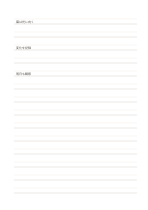

# 二本線の書字用紙

`ruled-double` · `foundation` · `a5-draft`

[繁體中文](README.zh-TW.md) · [English](README.en.md) · [日本語](README.ja.md) · [一覧へ戻る](../../docs/ja/catalog.md)

二本一組の横線を書字帯として使い、字の高さと間隔を見比べます。

## 向いている場面

- 文字の大きさをそろえる練習をするとき。
- 短い文を書き写し、行の基準を明確にしたいとき。

## 使い方

1. 二本の線を一行の上端と下端として選びます。
2. 短い文をその帯の中に収め、次の組にはみ出さないように書きます。
3. 数行後に字の高さと余白を比べ、次の行を調整します。

## 記入後に見えること

読み返せる連続した記録や下書きと、未確認の点が残ります。

## 記入例

架空の植物観察を三つの短い文にし、書字帯ごとの高さと間隔を比べる例です。

[SVG](examples/ja.svg)

## 向いていない場面

長文を素早く記録したり大きな絵を描いたりするには、二本線が制約になります。

## ダウンロード

- [文字なしSVG](exports/a5-draft/blank.svg)
- [文字なしPDF](exports/a5-draft/blank.pdf)
- [左上に英語名があるPDF](exports/a5-draft/titled.pdf)
- [濃い線の文字なしPDF](exports/a5-contrast/blank.pdf)
- [濃い線のSVG](exports/a5-contrast/blank.svg)

英語名は表題付きPDFだけに印刷され、文字なし版は自由な記入に使えます。

用紙サイズ：A5（148 × 210 mm）。設定ファイル：`a5-draft`。

## 由来と状態

伝統的な練習紙の応用 · 詳しい由来の記録： [manifest.json](manifest.json)  
[MITライセンスの範囲](../../LICENSE-SCOPE.md)

[三言語の用語集](../../docs/ja/glossary.md)

## 変更と再生成

`profiles/a5-draft.json` または `src/noteformats/layouts/` の描画関数を変更し、プロジェクトのルートで実行します：

`python scripts/build.py --ids ruled-double`
