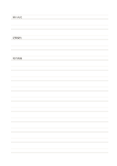

# 雙線書寫紙

`ruled-double` · `foundation` · `a5-draft`

[繁體中文](README.zh-TW.md) · [English](README.en.md) · [日本語](README.ja.md) · [返回目錄](../../docs/zh-TW/catalog.md)

每組兩條橫線形成一個書寫帶，幫助控制字高與間距。

## 適合情境

- 練習字形大小時，觀察上下緣是否一致。
- 抄寫短句時，給每行保留清楚的基準帶。

## 使用步驟

1. 選一組雙線作為一行的上下界。
2. 把一個短句寫在兩線之間，避免跨到下一組。
3. 寫完幾行後比較高度與留白，再調整下一行。

## 整理後可得到

留下可循序回看的筆記或草稿，標出仍待確認的部分。

## 實際填寫示例

示例以虛構植物觀察的三句短語練習等高書寫，逐行比較字高與行間。

[SVG](examples/zh-TW.svg)

## 不適合情境

長篇快速記錄或需要畫大圖時，成對線條會過度限制自由度。

## 下載

- [無字 SVG](exports/a5-draft/blank.svg)
- [無字 PDF](exports/a5-draft/blank.pdf)
- [左上角英文名稱 PDF](exports/a5-draft/titled.pdf)
- [深色墨線無字 PDF](exports/a5-contrast/blank.pdf)
- [深色墨線 SVG](exports/a5-contrast/blank.svg)

英文名稱只印在標題版 PDF；無字版仍適合自由列印與改作。

頁面尺寸：A5（148 × 210 mm）；設定檔：`a5-draft`。

## 來源與狀態

傳統書寫紙改編 · 詳細來源紀錄見 [manifest.json](manifest.json)  
[MIT 授權範圍](../../LICENSE-SCOPE.md)

[三語術語表](../../docs/zh-TW/glossary.md)

## 修改與重新生成

修改 `profiles/a5-draft.json` 或 `src/noteformats/layouts/` 內對應的繪圖函式，再於專案根目錄執行：

`python scripts/build.py --ids ruled-double`
