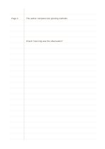

# Ruled notes with margin

`ruled-margin` · `foundation` · `a5-draft`

[繁體中文](README.zh-TW.md) · [English](README.en.md) · [日本語](README.ja.md) · [Back to catalog](../../docs/en/catalog.md)

Keep a narrow cue or reference margin beside a continuous writing area.

## When to use it

- Put page references in the margin while writing reading responses on the right.
- Mark sections of meeting notes that need follow-up.

## How to use it

1. Choose one role for the margin, such as sources, page numbers, or action marks.
2. Write full thoughts in the main area and only short cues at the side.
3. Review by scanning the margin, then reading the related main text.

## What the page helps you see

A continuous note or draft that can be revisited, with unresolved points marked.

## Worked example

The margin names a page of a fictional article, while the main area records an observation and a question to check.

[SVG](examples/en.svg)

## When not to use it

If cues need sentences or a substantial summary, the narrow margin is too small; use a Cornell page instead.

## Downloads

- [Wordless SVG](exports/a5-draft/blank.svg)
- [Wordless PDF](exports/a5-draft/blank.pdf)
- [PDF with English name at top left](exports/a5-draft/titled.pdf)
- [Darker-ink wordless PDF](exports/a5-contrast/blank.pdf)
- [Darker-ink SVG](exports/a5-contrast/blank.svg)

The English name appears only on the titled PDF; the wordless version remains available for free writing.

Page size: A5 (148 × 210 mm); profile: `a5-draft`.

## Provenance and status

Adaptation of traditional writing paper · Detailed source record: [manifest.json](manifest.json)  
[MIT license scope](../../LICENSE-SCOPE.md)

[Trilingual glossary](../../docs/en/glossary.md)

## Modify and rebuild

Change `profiles/a5-draft.json` or the corresponding builder in `src/noteformats/layouts/`, then run from the project root:

`python scripts/build.py --ids ruled-margin`
