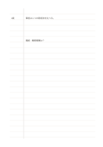

# 余白付き横罫

`ruled-margin` · `foundation` · `a5-draft`

[繁體中文](README.zh-TW.md) · [English](README.en.md) · [日本語](README.ja.md) · [一覧へ戻る](../../docs/ja/catalog.md)

狭い側欄に参照や印を置き、主な領域には文章を続けて書けます。

## 向いている場面

- 読書中、側欄にページを記し、右側に自分の理解を書くとき。
- 会議メモで後から対応する箇所に印を付けるとき。

## 使い方

1. 側欄を出典、ページ、対応印のどれに使うか決めます。
2. 主領域に文章を書き、側欄には短い手がかりだけを置きます。
3. 見直すときは側欄を追い、対応する本文を読みます。

## 記入後に見えること

読み返せる連続した記録や下書きと、未確認の点が残ります。

## 記入例

架空の記事のページを側欄に、筆者の観察と確認したい問いを主領域に書いています。

[SVG](examples/ja.svg)

## 向いていない場面

手がかりに長い文や要約が必要なら側欄が狭すぎます。コーネル式を検討してください。

## ダウンロード

- [文字なしSVG](exports/a5-draft/blank.svg)
- [文字なしPDF](exports/a5-draft/blank.pdf)
- [左上に英語名があるPDF](exports/a5-draft/titled.pdf)
- [濃い線の文字なしPDF](exports/a5-contrast/blank.pdf)
- [濃い線のSVG](exports/a5-contrast/blank.svg)

英語名は表題付きPDFだけに印刷され、文字なし版は自由な記入に使えます。

用紙サイズ：A5（148 × 210 mm）。設定ファイル：`a5-draft`。

## 由来と状態

伝統的な練習紙の応用 · 詳しい由来の記録： [manifest.json](manifest.json)  
[MITライセンスの範囲](../../LICENSE-SCOPE.md)

[三言語の用語集](../../docs/ja/glossary.md)

## 変更と再生成

`profiles/a5-draft.json` または `src/noteformats/layouts/` の描画関数を変更し、プロジェクトのルートで実行します：

`python scripts/build.py --ids ruled-margin`
