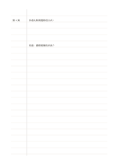

# 側欄橫線筆記

`ruled-margin` · `foundation` · `a5-draft`

[繁體中文](README.zh-TW.md) · [English](README.en.md) · [日本語](README.ja.md) · [返回目錄](../../docs/zh-TW/catalog.md)

保留一條窄側欄放索引或記號，主要區域仍可連續書寫。

## 適合情境

- 閱讀時在側欄記頁碼，右側寫自己的理解。
- 會議記錄時在側欄標記需要後續處理的段落。

## 使用步驟

1. 先決定側欄是放來源、頁碼還是待辦記號。
2. 在主區按行寫完整內容，側欄只放短提示。
3. 回顧時沿側欄掃描，再讀對應的主區文字。

## 整理後可得到

留下可循序回看的筆記或草稿，標出仍待確認的部分。

## 實際填寫示例

示例在側欄記虛構文章的頁次，主區記作者提出的觀察及自己待查的問題。

[SVG](examples/zh-TW.svg)

## 不適合情境

若提示需要長句或摘要，窄側欄不夠用；可改用康乃爾筆記。

## 下載

- [無字 SVG](exports/a5-draft/blank.svg)
- [無字 PDF](exports/a5-draft/blank.pdf)
- [左上角英文名稱 PDF](exports/a5-draft/titled.pdf)
- [深色墨線無字 PDF](exports/a5-contrast/blank.pdf)
- [深色墨線 SVG](exports/a5-contrast/blank.svg)

英文名稱只印在標題版 PDF；無字版仍適合自由列印與改作。

頁面尺寸：A5（148 × 210 mm）；設定檔：`a5-draft`。

## 來源與狀態

傳統書寫紙改編 · 詳細來源紀錄見 [manifest.json](manifest.json)  
[MIT 授權範圍](../../LICENSE-SCOPE.md)

[三語術語表](../../docs/zh-TW/glossary.md)

## 修改與重新生成

修改 `profiles/a5-draft.json` 或 `src/noteformats/layouts/` 內對應的繪圖函式，再於專案根目錄執行：

`python scripts/build.py --ids ruled-margin`
