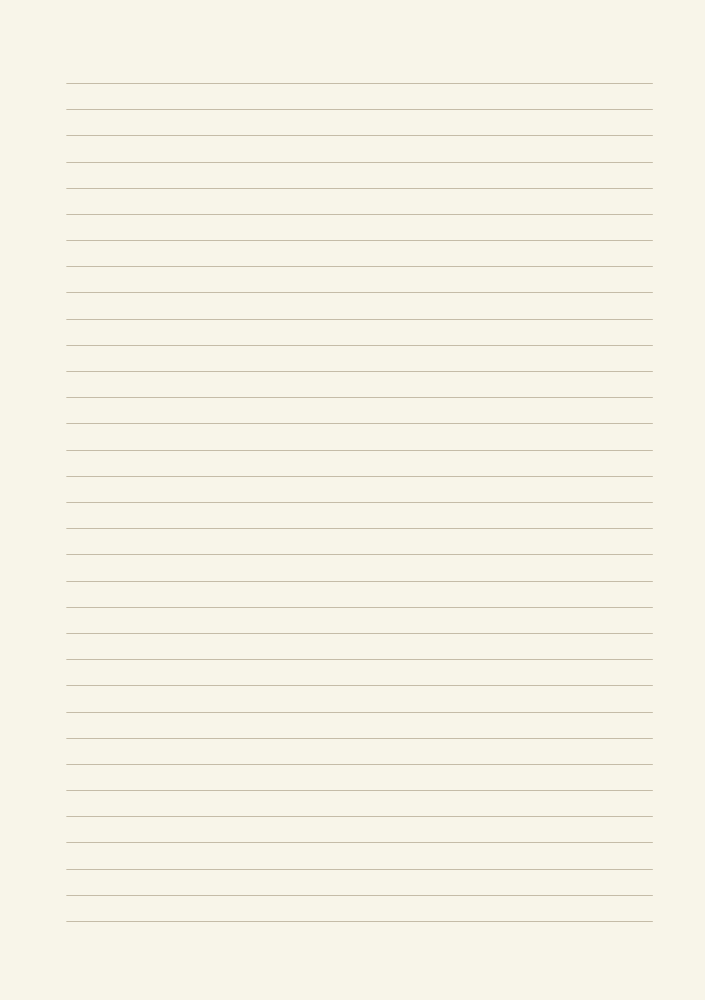
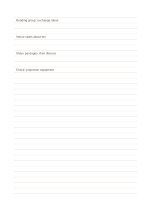

# Narrow ruled notes

`ruled-narrow` · `foundation` · `a5-draft`

[繁體中文](README.zh-TW.md) · [English](README.en.md) · [日本語](README.ja.md) · [Back to catalog](../../docs/en/catalog.md)

Record continuous sentences at a steady line spacing while keeping the page open to free writing. Geometry change: ruled line spacing: 5.5 mm.

## When to use it

**Geometry relationship:** `parameter` · [ruled-standard](../ruled-standard/README.en.md)

- Take compact, small-handwriting notes from a short talk on closely spaced lines.
- Write brief paragraph notes while reading a short essay, fitting more entries on one page.

## How to use it

1. Write the topic on the first line.
2. Start a new line for each new idea and continue related details underneath.
3. Mark claims that need checking with a symbol you will recognize.
4. Review those marks afterward and add the missing information near the original line.

## What the page helps you see

A continuous note or draft that can be revisited, with unresolved points marked.

## Worked example

The example follows a fictional neighborhood reading group: its aim, venue, sequence, equipment still to confirm, and a question for the next meeting. The fictional entries indicate where short notes belong; they are neither measured data nor a complete research conclusion.

[SVG](examples/en.svg)

## When not to use it

The 5.5 mm spacing suits compact handwriting; larger letters or frequent interline additions can crowd the page, so choose standard or wide ruling instead.

## Downloads

- [Wordless SVG](exports/a5-draft/blank.svg)
- [Wordless PDF](exports/a5-draft/blank.pdf)
- [PDF with English name at top left](exports/a5-draft/titled.pdf)
- [Darker-ink wordless PDF](exports/a5-contrast/blank.pdf)
- [Darker-ink SVG](exports/a5-contrast/blank.svg)

The English name appears only on the titled PDF; the wordless version remains available for free writing.

Page size: A5 (148 × 210 mm); profile: `a5-draft`.

## Provenance and status

Adaptation of traditional writing paper · Detailed source record: [manifest.json](manifest.json)  
[MIT license scope](../../LICENSE-SCOPE.md)

[Trilingual glossary](../../docs/en/glossary.md)

## Modify and rebuild

Edit geometry in `src/noteformats/variants.py` or text in `src/noteformats/variant_content.py`, then run from the project root:

`python scripts/build.py --ids ruled-narrow`
