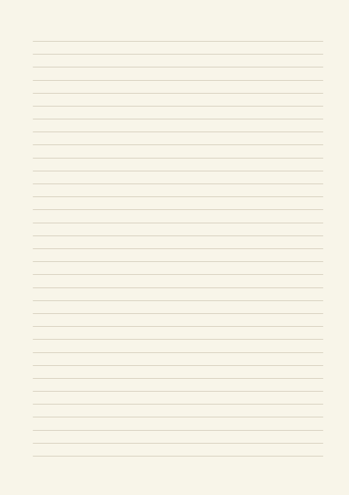
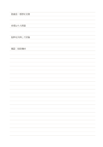

# 細い横罫ノート

`ruled-narrow` · `foundation` · `a5-draft`

[繁體中文](README.zh-TW.md) · [English](README.en.md) · [日本語](README.ja.md) · [一覧へ戻る](../../docs/ja/catalog.md)

一定の行間で文章を順に記録しながら、ページ全体を自由に使える形式です。 図形の変更： 横罫の間隔: 5.5 mm.

## 向いている場面

**図形の対応:** `parameter` · [ruled-standard](../ruled-standard/README.ja.md)

- 短い講演の要点を、小さな字と狭い行間で続けて記録するとき。
- 短い随筆を読み、段落ごとの短いメモを一ページに多く残すとき。

## 使い方

1. 一行目にこのページの主題を書きます。
2. 新しい考えは改行し、関連する内容はその下に続けます。
3. 確認が必要な記述には、自分で分かる印を付けます。
4. あとで印を見直し、分かったことを元の行の近くに追記します。

## 記入後に見えること

読み返せる連続した記録や下書きと、未確認の点が残ります。

## 記入例

架空の地域読書会を例に、目的、会場、進行、未確認の設備、次回の問いを順に記入しています。 架空の短い記入で各領域の使い方を示します。実測データや完全な調査結果ではありません。

[SVG](examples/ja.svg)

## 向いていない場面

5.5 mmの行間は小さな字向けです。大きな文字や行間の追記が多い場合は窮屈になるため、標準か広い横罫を選びます。

## ダウンロード

- [文字なしSVG](exports/a5-draft/blank.svg)
- [文字なしPDF](exports/a5-draft/blank.pdf)
- [左上に英語名があるPDF](exports/a5-draft/titled.pdf)
- [濃い線の文字なしPDF](exports/a5-contrast/blank.pdf)
- [濃い線のSVG](exports/a5-contrast/blank.svg)

英語名は表題付きPDFだけに印刷され、文字なし版は自由な記入に使えます。

用紙サイズ：A5（148 × 210 mm）。設定ファイル：`a5-draft`。

## 由来と状態

伝統的な練習紙の応用 · 詳しい由来の記録： [manifest.json](manifest.json)  
[MITライセンスの範囲](../../LICENSE-SCOPE.md)

[三言語の用語集](../../docs/ja/glossary.md)

## 変更と再生成

図形は `src/noteformats/variants.py`、文章は `src/noteformats/variant_content.py` を変更し、プロジェクトのルートで実行します：

`python scripts/build.py --ids ruled-narrow`
