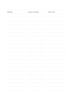

# Segmented ruled notes

`ruled-segmented` · `foundation` · `a5-draft`

[繁體中文](README.zh-TW.md) · [English](README.en.md) · [日本語](README.ja.md) · [Back to catalog](../../docs/en/catalog.md)

Split each row into three short writing lanes for related brief entries.

## When to use it

- Record time, observation, and question about the same event.
- Compare short excerpts from three sources on one topic.

## How to use it

1. Decide what the left, middle, and right lanes mean.
2. Keep related phrases on one row and move long explanations to a regular ruled page.
3. Scan rows for missing lanes and return to the source when needed.

## What the page helps you see

A continuous note or draft that can be revisited, with unresolved points marked.

## Worked example

A fictional plant observation uses the three lanes for time, visible condition, and a follow-up question.

[SVG](examples/en.svg)

## When not to use it

Narrow lanes cannot hold long explanations or serve as a table needing exact numeric columns.

## Downloads

- [Wordless SVG](exports/a5-draft/blank.svg)
- [Wordless PDF](exports/a5-draft/blank.pdf)
- [PDF with English name at top left](exports/a5-draft/titled.pdf)
- [Darker-ink wordless PDF](exports/a5-contrast/blank.pdf)
- [Darker-ink SVG](exports/a5-contrast/blank.svg)

The English name appears only on the titled PDF; the wordless version remains available for free writing.

Page size: A5 (148 × 210 mm); profile: `a5-draft`.

## Provenance and status

Original layout · Detailed source record: [manifest.json](manifest.json)  
[MIT license scope](../../LICENSE-SCOPE.md)

[Trilingual glossary](../../docs/en/glossary.md)

## Modify and rebuild

Change `profiles/a5-draft.json` or the corresponding builder in `src/noteformats/layouts/`, then run from the project root:

`python scripts/build.py --ids ruled-segmented`
