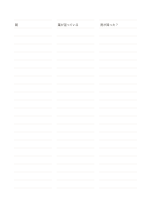

# 三分割の横罫

`ruled-segmented` · `foundation` · `a5-draft`

[繁體中文](README.zh-TW.md) · [English](README.en.md) · [日本語](README.ja.md) · [一覧へ戻る](../../docs/ja/catalog.md)

各行を三つの短い記入欄に分け、関連する語句を横並びで残します。

## 向いている場面

- 同じ出来事の時刻、観察、疑問を並べるとき。
- 一つの話題について三つの資料の短い抜粋を比べるとき。

## 使い方

1. 左・中央・右の欄が何を表すか決めます。
2. 一行には関連する短い語句だけを書き、長い説明は別の横罫に移します。
3. 空欄を見直し、必要なら元の資料に戻って補います。

## 記入後に見えること

読み返せる連続した記録や下書きと、未確認の点が残ります。

## 記入例

架空の植物観察で、三欄に時刻、見えた状態、次の問いを並べています。

[SVG](examples/ja.svg)

## 向いていない場面

各欄が狭いため長い説明や正確な数値幅を要する表には向きません。

## ダウンロード

- [文字なしSVG](exports/a5-draft/blank.svg)
- [文字なしPDF](exports/a5-draft/blank.pdf)
- [左上に英語名があるPDF](exports/a5-draft/titled.pdf)
- [濃い線の文字なしPDF](exports/a5-contrast/blank.pdf)
- [濃い線のSVG](exports/a5-contrast/blank.svg)

英語名は表題付きPDFだけに印刷され、文字なし版は自由な記入に使えます。

用紙サイズ：A5（148 × 210 mm）。設定ファイル：`a5-draft`。

## 由来と状態

本プロジェクトの独自レイアウト · 詳しい由来の記録： [manifest.json](manifest.json)  
[MITライセンスの範囲](../../LICENSE-SCOPE.md)

[三言語の用語集](../../docs/ja/glossary.md)

## 変更と再生成

`profiles/a5-draft.json` または `src/noteformats/layouts/` の描画関数を変更し、プロジェクトのルートで実行します：

`python scripts/build.py --ids ruled-segmented`
