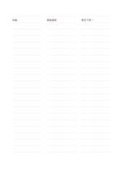

# 三段短句橫線

`ruled-segmented` · `foundation` · `a5-draft`

[繁體中文](README.zh-TW.md) · [English](README.en.md) · [日本語](README.ja.md) · [返回目錄](../../docs/zh-TW/catalog.md)

把每一行拆成三個短寫區，方便並列記錄相關的短項目。

## 適合情境

- 觀察同一件事的時間、現象與疑問。
- 整理三種來源對同一主題的短摘記。

## 使用步驟

1. 先決定左、中、右三段各代表什麼。
2. 同一列只放互相關聯的短語，長句另寫在普通橫線頁。
3. 逐列比較缺少哪一段，回頭補資料。

## 整理後可得到

留下可循序回看的筆記或草稿，標出仍待確認的部分。

## 實際填寫示例

以虛構的植物觀察為例，三段分別記時間、看到的現象和想追問的事。

[SVG](examples/zh-TW.svg)

## 不適合情境

每段寬度有限，不適合長篇解釋或需要精確數字欄寬的表格。

## 下載

- [無字 SVG](exports/a5-draft/blank.svg)
- [無字 PDF](exports/a5-draft/blank.pdf)
- [左上角英文名稱 PDF](exports/a5-draft/titled.pdf)
- [深色墨線無字 PDF](exports/a5-contrast/blank.pdf)
- [深色墨線 SVG](exports/a5-contrast/blank.svg)

英文名稱只印在標題版 PDF；無字版仍適合自由列印與改作。

頁面尺寸：A5（148 × 210 mm）；設定檔：`a5-draft`。

## 來源與狀態

本專案原創版面 · 詳細來源紀錄見 [manifest.json](manifest.json)  
[MIT 授權範圍](../../LICENSE-SCOPE.md)

[三語術語表](../../docs/zh-TW/glossary.md)

## 修改與重新生成

修改 `profiles/a5-draft.json` 或 `src/noteformats/layouts/` 內對應的繪圖函式，再於專案根目錄執行：

`python scripts/build.py --ids ruled-segmented`
