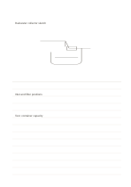

# Sketch above, notes below

`ruled-sketch-top` · `foundation` · `a5-draft`

[繁體中文](README.zh-TW.md) · [English](README.en.md) · [日本語](README.ja.md) · [Back to catalog](../../docs/en/catalog.md)

Draw a concept in the large upper area, then explain it on ruled lines beneath.

## When to use it

- Observe an object's shape before noting material and dimension questions.
- Sketch a process and then describe its stages line by line.

## How to use it

1. Draw the main structure in the open upper area without needing to fill it.
2. Circle or point to parts that deserve explanation.
3. Use the lower lines for observations, hypotheses, and questions still to check.

## What the page helps you see

A continuous note or draft that can be revisited, with unresolved points marked.

## Worked example

The upper space roughly depicts a fictional rainwater collector, while the lower lines note the inlet, filter, and capacity to test.

[SVG](examples/en.svg)

## When not to use it

The sketch area is wasted for text-only work; a drawing needing page-wide precision belongs on a blank sheet.

## Downloads

- [Wordless SVG](exports/a5-draft/blank.svg)
- [Wordless PDF](exports/a5-draft/blank.pdf)
- [PDF with English name at top left](exports/a5-draft/titled.pdf)
- [Darker-ink wordless PDF](exports/a5-contrast/blank.pdf)
- [Darker-ink SVG](exports/a5-contrast/blank.svg)

The English name appears only on the titled PDF; the wordless version remains available for free writing.

Page size: A5 (148 × 210 mm); profile: `a5-draft`.

## Provenance and status

Original mixed layout · Detailed source record: [manifest.json](manifest.json)  
[MIT license scope](../../LICENSE-SCOPE.md)

[Trilingual glossary](../../docs/en/glossary.md)

## Modify and rebuild

Change `profiles/a5-draft.json` or the corresponding builder in `src/noteformats/layouts/`, then run from the project root:

`python scripts/build.py --ids ruled-sketch-top`
