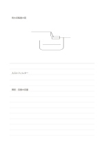

# 上図下文のノート

`ruled-sketch-top` · `foundation` · `a5-draft`

[繁體中文](README.zh-TW.md) · [English](README.en.md) · [日本語](README.ja.md) · [一覧へ戻る](../../docs/ja/catalog.md)

上の広い余白に考えを描き、下の横罫に説明を加えます。

## 向いている場面

- 物の外形を記録してから材料や寸法の疑問を書くとき。
- 工程の下描きを作り、各段階を文章で説明するとき。

## 使い方

1. 上の余白に主要な構造を描き、無理に埋めません。
2. 説明したい部分を囲みや矢印で示します。
3. 下の横罫に観察、仮説、まだ確かめたい点を順に書きます。

## 記入後に見えること

読み返せる連続した記録や下書きと、未確認の点が残ります。

## 記入例

上に架空の雨水収集器を大まかに描き、下に入口、フィルター、試したい容量を記しています。

[SVG](examples/ja.svg)

## 向いていない場面

文章だけなら描画欄が余ります。全面を精密に描くなら無地のページが適します。

## ダウンロード

- [文字なしSVG](exports/a5-draft/blank.svg)
- [文字なしPDF](exports/a5-draft/blank.pdf)
- [左上に英語名があるPDF](exports/a5-draft/titled.pdf)
- [濃い線の文字なしPDF](exports/a5-contrast/blank.pdf)
- [濃い線のSVG](exports/a5-contrast/blank.svg)

英語名は表題付きPDFだけに印刷され、文字なし版は自由な記入に使えます。

用紙サイズ：A5（148 × 210 mm）。設定ファイル：`a5-draft`。

## 由来と状態

本プロジェクトの独自の複合配置 · 詳しい由来の記録： [manifest.json](manifest.json)  
[MITライセンスの範囲](../../LICENSE-SCOPE.md)

[三言語の用語集](../../docs/ja/glossary.md)

## 変更と再生成

`profiles/a5-draft.json` または `src/noteformats/layouts/` の描画関数を変更し、プロジェクトのルートで実行します：

`python scripts/build.py --ids ruled-sketch-top`
