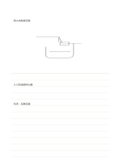

# 上圖下文筆記

`ruled-sketch-top` · `foundation` · `a5-draft`

[繁體中文](README.zh-TW.md) · [English](README.en.md) · [日本語](README.ja.md) · [返回目錄](../../docs/zh-TW/catalog.md)

先在大留白區畫概念，再在下方橫線區說明。

## 適合情境

- 記錄物件外觀後，補上材料與尺寸疑問。
- 畫出流程草圖後，逐行說明每個階段。

## 使用步驟

1. 先在上方留白畫主要結構，不必填滿。
2. 用箭頭或圈線標出值得說明的部位。
3. 在下方逐行寫觀察、假設與尚待確認事項。

## 整理後可得到

留下可循序回看的筆記或草稿，標出仍待確認的部分。

## 實際填寫示例

示例上方概略畫虛構雨水收集器，下方記入口、濾網與待測的容量問題。

[SVG](examples/zh-TW.svg)

## 不適合情境

如果全部內容都是長文，空白畫區可能浪費；若圖需要滿頁精度，也應選全空白頁。

## 下載

- [無字 SVG](exports/a5-draft/blank.svg)
- [無字 PDF](exports/a5-draft/blank.pdf)
- [左上角英文名稱 PDF](exports/a5-draft/titled.pdf)
- [深色墨線無字 PDF](exports/a5-contrast/blank.pdf)
- [深色墨線 SVG](exports/a5-contrast/blank.svg)

英文名稱只印在標題版 PDF；無字版仍適合自由列印與改作。

頁面尺寸：A5（148 × 210 mm）；設定檔：`a5-draft`。

## 來源與狀態

本專案原創混合版面 · 詳細來源紀錄見 [manifest.json](manifest.json)  
[MIT 授權範圍](../../LICENSE-SCOPE.md)

[三語術語表](../../docs/zh-TW/glossary.md)

## 修改與重新生成

修改 `profiles/a5-draft.json` 或 `src/noteformats/layouts/` 內對應的繪圖函式，再於專案根目錄執行：

`python scripts/build.py --ids ruled-sketch-top`
