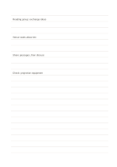

# Ruled notes

`ruled-standard` · `foundation` · `a5-draft`

[繁體中文](README.zh-TW.md) · [English](README.en.md) · [日本語](README.ja.md) · [Back to catalog](../../docs/en/catalog.md)

Record continuous sentences at a steady line spacing while keeping the page open to free writing.

## When to use it

- Capture points in order after a short talk.
- Write questions and responses paragraph by paragraph while reading an essay.

## How to use it

1. Write the topic on the first line.
2. Start a new line for each new idea and continue related details underneath.
3. Mark claims that need checking with a symbol you will recognize.
4. Review those marks afterward and add the missing information near the original line.

## What the page helps you see

A continuous note or draft that can be revisited, with unresolved points marked.

## Worked example

The example follows a fictional neighborhood reading group: its aim, venue, sequence, equipment still to confirm, and a question for the next meeting.

[SVG](examples/en.svg)

## When not to use it

Continuous lines are awkward when several options need side-by-side comparison or when the relationships between causes matter.

## Downloads

- [Wordless SVG](exports/a5-draft/blank.svg)
- [Wordless PDF](exports/a5-draft/blank.pdf)
- [PDF with English name at top left](exports/a5-draft/titled.pdf)
- [Darker-ink wordless PDF](exports/a5-contrast/blank.pdf)
- [Darker-ink SVG](exports/a5-contrast/blank.svg)

The English name appears only on the titled PDF; the wordless version remains available for free writing.

Page size: A5 (148 × 210 mm); profile: `a5-draft`.

## Provenance and status

Adaptation of traditional writing paper · Detailed source record: [manifest.json](manifest.json)  
[MIT license scope](../../LICENSE-SCOPE.md)

[Trilingual glossary](../../docs/en/glossary.md)

## Modify and rebuild

Change `profiles/a5-draft.json` or the corresponding builder in `src/noteformats/layouts/`, then run from the project root:

`python scripts/build.py --ids ruled-standard`
