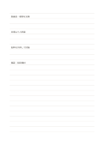

# 横罫ノート

`ruled-standard` · `foundation` · `a5-draft`

[繁體中文](README.zh-TW.md) · [English](README.en.md) · [日本語](README.ja.md) · [一覧へ戻る](../../docs/ja/catalog.md)

一定の行間で文章を順に記録しながら、ページ全体を自由に使える形式です。

## 向いている場面

- 短い講演を聞いたあと、話の流れに沿って要点を残すとき。
- 随筆を読み、段落ごとに疑問と自分の考えを書くとき。

## 使い方

1. 一行目にこのページの主題を書きます。
2. 新しい考えは改行し、関連する内容はその下に続けます。
3. 確認が必要な記述には、自分で分かる印を付けます。
4. あとで印を見直し、分かったことを元の行の近くに追記します。

## 記入後に見えること

読み返せる連続した記録や下書きと、未確認の点が残ります。

## 記入例

架空の地域読書会を例に、目的、会場、進行、未確認の設備、次回の問いを順に記入しています。

[SVG](examples/ja.svg)

## 向いていない場面

複数の案を横並びで比べたり、原因同士の関係を描いたりするには、横罫だけでは見通しが悪くなります。

## ダウンロード

- [文字なしSVG](exports/a5-draft/blank.svg)
- [文字なしPDF](exports/a5-draft/blank.pdf)
- [左上に英語名があるPDF](exports/a5-draft/titled.pdf)
- [濃い線の文字なしPDF](exports/a5-contrast/blank.pdf)
- [濃い線のSVG](exports/a5-contrast/blank.svg)

英語名は表題付きPDFだけに印刷され、文字なし版は自由な記入に使えます。

用紙サイズ：A5（148 × 210 mm）。設定ファイル：`a5-draft`。

## 由来と状態

伝統的な練習紙の応用 · 詳しい由来の記録： [manifest.json](manifest.json)  
[MITライセンスの範囲](../../LICENSE-SCOPE.md)

[三言語の用語集](../../docs/ja/glossary.md)

## 変更と再生成

`profiles/a5-draft.json` または `src/noteformats/layouts/` の描画関数を変更し、プロジェクトのルートで実行します：

`python scripts/build.py --ids ruled-standard`
