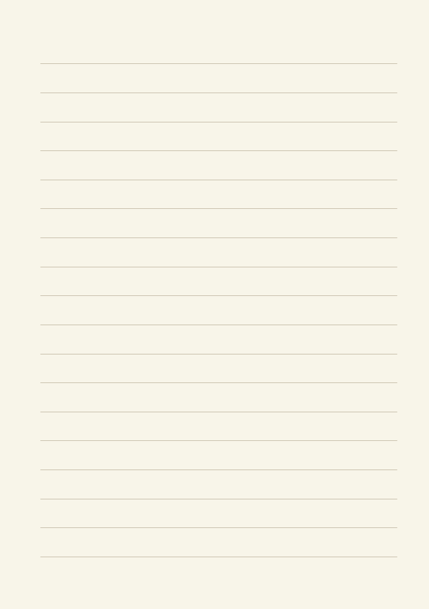
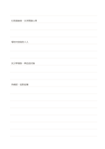

# 寬行距橫線

`ruled-wide` · `foundation` · `a5-draft`

[繁體中文](README.zh-TW.md) · [English](README.en.md) · [日本語](README.ja.md) · [返回目錄](../../docs/zh-TW/catalog.md)

以固定行距連續記錄句子，保留整頁自由書寫的空間。 本款的幾何變化： 橫線行距: 10 mm.

## 適合情境

**幾何對照:** `parameter` · [ruled-standard](../ruled-standard/README.zh-TW.md)

- 用較大字跡整理訪談重點，讓各行之間留出補字空間。
- 練寫短句時希望行與行分得更開，方便圈出要修改的字。

## 使用步驟

1. 先在第一行寫下這頁的主題。
2. 每個新想法換行，相關內容接在其後。
3. 遇到需要查證的敘述，在旁邊做自己看得懂的記號。
4. 結束時回看記號，把待查內容補到原句附近。

## 整理後可得到

留下可循序回看的筆記或草稿，標出仍待確認的部分。

## 實際填寫示例

示例記錄一次虛構的社區讀書會：先寫活動目標，再記場地、流程、尚待確認的設備，最後留下下一次討論的問題。 示例以虛構資料在對應區域放入短語，示意填寫位置；不是實測或完整研究結論。

[SVG](examples/zh-TW.svg)

## 不適合情境

10 mm 行距方便放大字跡，但同頁可寫行數較少；長篇逐字稿需要更多頁，不能靠縮小字體恢復容量。

## 下載

- [無字 SVG](exports/a5-draft/blank.svg)
- [無字 PDF](exports/a5-draft/blank.pdf)
- [左上角英文名稱 PDF](exports/a5-draft/titled.pdf)
- [深色墨線無字 PDF](exports/a5-contrast/blank.pdf)
- [深色墨線 SVG](exports/a5-contrast/blank.svg)

英文名稱只印在標題版 PDF；無字版仍適合自由列印與改作。

頁面尺寸：A5（148 × 210 mm）；設定檔：`a5-draft`。

## 來源與狀態

傳統書寫紙改編 · 詳細來源紀錄見 [manifest.json](manifest.json)  
[MIT 授權範圍](../../LICENSE-SCOPE.md)

[三語術語表](../../docs/zh-TW/glossary.md)

## 修改與重新生成

調整 `src/noteformats/variants.py` 的幾何或 `src/noteformats/variant_content.py` 的文字，再於專案根目錄執行：

`python scripts/build.py --ids ruled-wide`
