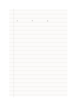

# Seyès-style ruled draft

`seyes-ruled` · `special-paper` · `a5-draft`

[繁體中文](README.zh-TW.md) · [English](README.en.md) · [日本語](README.ja.md) · [Back to catalog](../../docs/en/catalog.md)

Use closely spaced guides to practice letter height and baseline placement.

## When to use it

- Practice differences in Latin lowercase and uppercase height.
- Compare several handwriting shapes on one sheet.

## How to use it

1. Treat every fourth, darker line as a main baseline.
2. Use pale lines to guide lowercase height without tracing them mechanically.
3. Note the exercise in the left margin and compare height consistency afterward.

## What the page helps you see

Notation, letterforms, or sketches aligned to the specialized guides.

## Worked example

Editable a, b, and g on the first guide group illustrate ascender and descender positions.

[SVG](examples/en.svg)

## When not to use it

This is a provisional Seyès-style draft, not certified to a school standard. Two-millimetre guide print quality is untested.

## Downloads

- [Wordless SVG](exports/a5-draft/blank.svg)
- [Wordless PDF](exports/a5-draft/blank.pdf)
- [PDF with English name at top left](exports/a5-draft/titled.pdf)
- [Darker-ink wordless PDF](exports/a5-contrast/blank.pdf)
- [Darker-ink SVG](exports/a5-contrast/blank.svg)

The English name appears only on the titled PDF; the wordless version remains available for free writing.

Page size: A5 (148 × 210 mm); profile: `a5-draft`.

## Provenance and status

Common geometry · Detailed source record: [manifest.json](manifest.json)  
[MIT license scope](../../LICENSE-SCOPE.md)

[Trilingual glossary](../../docs/en/glossary.md)

## Modify and rebuild

Change `profiles/a5-draft.json` or the corresponding builder in `src/noteformats/layouts/`, then run from the project root:

`python scripts/build.py --ids seyes-ruled`
