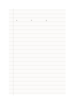

# フランス式補助罫の草案

`seyes-ruled` · `special-paper` · `a5-draft`

[繁體中文](README.zh-TW.md) · [English](README.en.md) · [日本語](README.ja.md) · [一覧へ戻る](../../docs/ja/catalog.md)

細かい補助線でラテン文字の高さと基線を練習します。

## 向いている場面

- 小文字と大文字の高さの違いを見るとき。
- 同じ紙で複数の手書き字形を比べるとき。

## 使い方

1. 四本ごとの濃い線を主な基線として見ます。
2. 薄い線を小文字の高さの目安にし、機械的になぞりません。
3. 左の余白に課題を記し、書いた後で字高を比べます。

## 記入後に見えること

専用の罫線に沿った記譜、文字、下書きを確認できます。

## 記入例

最初の線群に編集可能な a、b、g を置き、上に伸びる部分と下がる部分を見ます。

[SVG](examples/ja.svg)

## 向いていない場面

暫定のSeyès風罫線であり、学校の正式規格への適合は主張しません。2 mm線の印刷は未試験です。

## ダウンロード

- [文字なしSVG](exports/a5-draft/blank.svg)
- [文字なしPDF](exports/a5-draft/blank.pdf)
- [左上に英語名があるPDF](exports/a5-draft/titled.pdf)
- [濃い線の文字なしPDF](exports/a5-contrast/blank.pdf)
- [濃い線のSVG](exports/a5-contrast/blank.svg)

英語名は表題付きPDFだけに印刷され、文字なし版は自由な記入に使えます。

用紙サイズ：A5（148 × 210 mm）。設定ファイル：`a5-draft`。

## 由来と状態

一般的な幾何構造 · 詳しい由来の記録： [manifest.json](manifest.json)  
[MITライセンスの範囲](../../LICENSE-SCOPE.md)

[三言語の用語集](../../docs/ja/glossary.md)

## 変更と再生成

`profiles/a5-draft.json` または `src/noteformats/layouts/` の描画関数を変更し、プロジェクトのルートで実行します：

`python scripts/build.py --ids seyes-ruled`
