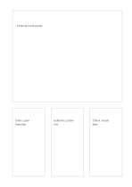

# Source card and three notes

`source-large-plus-cards` · `research` · `a5-draft`

[繁體中文](README.zh-TW.md) · [English](README.en.md) · [日本語](README.ja.md) · [Back to catalog](../../docs/en/catalog.md)

Name a source in the large card and use three smaller cards for claim, evidence, and question.

## When to use it

**Geometry relationship:** `equivalent` · [hero-three-cards](../hero-three-cards/README.en.md)

- Record an event poster on the main card and separate its claim, evidence and date check into three smaller cards.
- Study one core article with three small cards for quotation, interpretation and follow-up questions.

## How to use it

1. Record the source title, provenance and passage to retain on the main card.
2. Use the three small cards for a claim, supporting evidence and open questions, separating quotations from your words.
3. Check the small cards against the original source and flag missing provenance or dates.

## What the page helps you see

Sources, quotations, claims, and open checks kept distinct.

## Worked example

Entries in example-position order; each number identifies one entry:

1. Fictional event poster
2. Claim: open Saturday
3. Evidence: poster text
4. Check: actual date

[SVG](examples/en.svg)

## When not to use it

A source card with three annotation cards still centers on one source; agreement among those cards is not corroboration by several independent sources.

## Downloads

- [Wordless SVG](exports/a5-draft/blank.svg)
- [Wordless PDF](exports/a5-draft/blank.pdf)
- [PDF with English name at top left](exports/a5-draft/titled.pdf)
- [Darker-ink wordless PDF](exports/a5-contrast/blank.pdf)
- [Darker-ink SVG](exports/a5-contrast/blank.svg)

The English name appears only on the titled PDF; the wordless version remains available for free writing.

Page size: A5 (148 × 210 mm); profile: `a5-draft`.

## Provenance and status

Original layout · Detailed source record: [manifest.json](manifest.json)  
[MIT license scope](../../LICENSE-SCOPE.md)

[Trilingual glossary](../../docs/en/glossary.md)

## Modify and rebuild

Edit geometry in `src/noteformats/variants.py` or text in `src/noteformats/variant_content.py`, then run from the project root:

`python scripts/build.py --ids source-large-plus-cards`
