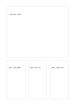

# 資料カードと三つのメモ

`source-large-plus-cards` · `research` · `a5-draft`

[繁體中文](README.zh-TW.md) · [English](README.en.md) · [日本語](README.ja.md) · [一覧へ戻る](../../docs/ja/catalog.md)

大きいカードに資料、小さい三枚に主張、根拠、確認点を記します。

## 向いている場面

**図形の対応:** `equivalent` · [hero-three-cards](../hero-three-cards/README.ja.md)

- 主カードに催しの掲示を記録し、小カード三枚に主張・根拠・日付の確認を分けるとき。
- 一つの中心記事を読み、三枚の小カードに引用・解釈・追加の問いを分けるとき。

## 使い方

1. 主カードに資料名・出典・残したい原文を書きます。
2. 三枚の小カードに主張・根拠・確認点を分け、引用と自分の言葉を区別します。
3. 元資料へ戻って各カードを照合し、出典や日付の不足に印を付けます。

## 記入後に見えること

資料、引用、主張、未確認事項を分けられます。

## 記入例

図の記入位置の順に示します。番号一つが一つの記入例です：

1. 架空の催しの掲示
2. 主張：土曜に開場
3. 根拠：掲示の文
4. 確認：実際の日付

[SVG](examples/ja.svg)

## 向いていない場面

主資料一枚と注記三枚でも、扱う中心は一つの出典です。カード同士が一致していても、複数の独立資料による裏付けにはなりません。

## ダウンロード

- [文字なしSVG](exports/a5-draft/blank.svg)
- [文字なしPDF](exports/a5-draft/blank.pdf)
- [左上に英語名があるPDF](exports/a5-draft/titled.pdf)
- [濃い線の文字なしPDF](exports/a5-contrast/blank.pdf)
- [濃い線のSVG](exports/a5-contrast/blank.svg)

英語名は表題付きPDFだけに印刷され、文字なし版は自由な記入に使えます。

用紙サイズ：A5（148 × 210 mm）。設定ファイル：`a5-draft`。

## 由来と状態

本プロジェクトの独自レイアウト · 詳しい由来の記録： [manifest.json](manifest.json)  
[MITライセンスの範囲](../../LICENSE-SCOPE.md)

[三言語の用語集](../../docs/ja/glossary.md)

## 変更と再生成

図形は `src/noteformats/variants.py`、文章は `src/noteformats/variant_content.py` を変更し、プロジェクトのルートで実行します：

`python scripts/build.py --ids source-large-plus-cards`
