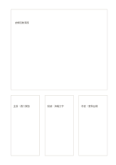

# 資料主卡與三註

`source-large-plus-cards` · `research` · `a5-draft`

[繁體中文](README.zh-TW.md) · [English](README.en.md) · [日本語](README.ja.md) · [返回目錄](../../docs/zh-TW/catalog.md)

主卡標示資料，三小卡記主張、依據與待查之處。

## 適合情境

**幾何對照:** `equivalent` · [hero-three-cards](../hero-three-cards/README.zh-TW.md)

- 在主卡記錄一份活動海報，旁邊三卡分別放主張、依據與待查日期。
- 整理一篇核心文章時，用三張小卡區分引文、解讀與追問。

## 使用步驟

1. 主卡記下資料的標題、來源與要保留的原文。
2. 三張小卡分別放主張、支持依據與待查問題，區分引文和自己的話。
3. 回到原資料核對各張小卡，將缺少來源或日期的地方標出。

## 整理後可得到

分開來源、引文、主張與待查問題。

## 實際填寫示例

依圖中填寫位置順序列出，每個編號是一筆示例條目：

1. 虛構活動海報
2. 主張：週六開放
3. 依據：海報文字
4. 待查：實際日期

[SVG](examples/zh-TW.svg)

## 不適合情境

一張資料主卡加三張註記卡，仍然只圍繞單一來源；卡片彼此一致不能當成多個獨立來源的交叉佐證。

## 下載

- [無字 SVG](exports/a5-draft/blank.svg)
- [無字 PDF](exports/a5-draft/blank.pdf)
- [左上角英文名稱 PDF](exports/a5-draft/titled.pdf)
- [深色墨線無字 PDF](exports/a5-contrast/blank.pdf)
- [深色墨線 SVG](exports/a5-contrast/blank.svg)

英文名稱只印在標題版 PDF；無字版仍適合自由列印與改作。

頁面尺寸：A5（148 × 210 mm）；設定檔：`a5-draft`。

## 來源與狀態

本專案原創版面 · 詳細來源紀錄見 [manifest.json](manifest.json)  
[MIT 授權範圍](../../LICENSE-SCOPE.md)

[三語術語表](../../docs/zh-TW/glossary.md)

## 修改與重新生成

調整 `src/noteformats/variants.py` 的幾何或 `src/noteformats/variant_content.py` 的文字，再於專案根目錄執行：

`python scripts/build.py --ids source-large-plus-cards`
