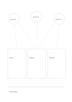

# Linked source notes

`source-network-notes` · `research` · `a5-draft`

[繁體中文](README.zh-TW.md) · [English](README.en.md) · [日本語](README.ja.md) · [Back to catalog](../../docs/en/catalog.md)

Compare notes from three sources and flag observations supported across sources.

## When to use it

- Compare three public articles on one issue.
- Bring observations from three fictional interviews together.

## How to use it

1. Give each upper circle a traceable source shorthand.
2. Record its observation in a middle card; cross-lines mark comparisons to make.
3. Write one provisional synthesis below, noting contradictions or gaps.

## What the page helps you see

Sources, quotations, claims, and open checks kept distinct.

## Worked example

Fictional sources A, B, and C discuss shared space; notes cover opening hours, seating, and booking rules, while dates need checking.

[SVG](examples/en.svg)

## When not to use it

Cross-links do not prove source independence; full references and page numbers still belong in a proper citation record.

## Downloads

- [Wordless SVG](exports/a5-draft/blank.svg)
- [Wordless PDF](exports/a5-draft/blank.pdf)
- [PDF with English name at top left](exports/a5-draft/titled.pdf)
- [Darker-ink wordless PDF](exports/a5-contrast/blank.pdf)
- [Darker-ink SVG](exports/a5-contrast/blank.svg)

The English name appears only on the titled PDF; the wordless version remains available for free writing.

Page size: A5 (148 × 210 mm); profile: `a5-draft`.

## Provenance and status

Original layout · Detailed source record: [manifest.json](manifest.json)  
[MIT license scope](../../LICENSE-SCOPE.md)

[Trilingual glossary](../../docs/en/glossary.md)

## Modify and rebuild

Change `profiles/a5-draft.json` or the corresponding builder in `src/noteformats/layouts/`, then run from the project root:

`python scripts/build.py --ids source-network-notes`
