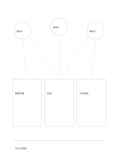

# 資料を結ぶメモ

`source-network-notes` · `research` · `a5-draft`

[繁體中文](README.zh-TW.md) · [English](README.en.md) · [日本語](README.ja.md) · [一覧へ戻る](../../docs/ja/catalog.md)

三つの資料からのメモを比べ、複数資料に関わる観察を見つけます。

## 向いている場面

- 同じ話題を扱う三つの公開記事を比べるとき。
- 架空の三回の聞き取りをまとめるとき。

## 使い方

1. 上の三円に追跡できる資料の略称を書きます。
2. 中段に対応する観察を記し、交差線は比較する箇所として読みます。
3. 下に暫定の総合を一文で書き、矛盾や空白も示します。

## 記入後に見えること

資料、引用、主張、未確認事項を分けられます。

## 記入例

架空の資料A、B、Cから開館時間、座席、予約規則を比べ、下段で日付の確認が必要と記します。

[SVG](examples/ja.svg)

## 向いていない場面

交差線は資料の独立性の証明ではありません。正式な引用には書誌とページを別に記します。

## ダウンロード

- [文字なしSVG](exports/a5-draft/blank.svg)
- [文字なしPDF](exports/a5-draft/blank.pdf)
- [左上に英語名があるPDF](exports/a5-draft/titled.pdf)
- [濃い線の文字なしPDF](exports/a5-contrast/blank.pdf)
- [濃い線のSVG](exports/a5-contrast/blank.svg)

英語名は表題付きPDFだけに印刷され、文字なし版は自由な記入に使えます。

用紙サイズ：A5（148 × 210 mm）。設定ファイル：`a5-draft`。

## 由来と状態

本プロジェクトの独自レイアウト · 詳しい由来の記録： [manifest.json](manifest.json)  
[MITライセンスの範囲](../../LICENSE-SCOPE.md)

[三言語の用語集](../../docs/ja/glossary.md)

## 変更と再生成

`profiles/a5-draft.json` または `src/noteformats/layouts/` の描画関数を変更し、プロジェクトのルートで実行します：

`python scripts/build.py --ids source-network-notes`
