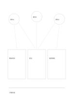

# 多來源連結筆記

`source-network-notes` · `research` · `a5-draft`

[繁體中文](README.zh-TW.md) · [English](README.en.md) · [日本語](README.ja.md) · [返回目錄](../../docs/zh-TW/catalog.md)

對照三個來源的筆記，標出兩個來源同時支援的觀察。

## 適合情境

- 比較三篇公開文章對同一議題的說法。
- 把三次虛構訪談的觀察放在一起整理。

## 使用步驟

1. 上方三圓各寫可回查的來源簡稱。
2. 中間卡片各記對應的觀察；交叉線表示需比較的資料。
3. 底部寫目前可綜合的一句話，並標出矛盾或空白。

## 整理後可得到

分開來源、引文、主張與待查問題。

## 實際填寫示例

虛構社區資料 A、B、C 都談使用空間；中間記開放時段、座位及借用規則，底部寫需確認不同來源的日期。

[SVG](examples/zh-TW.svg)

## 不適合情境

連線不等於來源相互獨立；正式引用仍需另記完整書目與頁碼。

## 下載

- [無字 SVG](exports/a5-draft/blank.svg)
- [無字 PDF](exports/a5-draft/blank.pdf)
- [左上角英文名稱 PDF](exports/a5-draft/titled.pdf)
- [深色墨線無字 PDF](exports/a5-contrast/blank.pdf)
- [深色墨線 SVG](exports/a5-contrast/blank.svg)

英文名稱只印在標題版 PDF；無字版仍適合自由列印與改作。

頁面尺寸：A5（148 × 210 mm）；設定檔：`a5-draft`。

## 來源與狀態

本專案原創版面 · 詳細來源紀錄見 [manifest.json](manifest.json)  
[MIT 授權範圍](../../LICENSE-SCOPE.md)

[三語術語表](../../docs/zh-TW/glossary.md)

## 修改與重新生成

修改 `profiles/a5-draft.json` 或 `src/noteformats/layouts/` 內對應的繪圖函式，再於專案根目錄執行：

`python scripts/build.py --ids source-network-notes`
